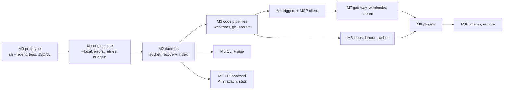

# mill backend plan: overview

The backend and tech-stack plan for mill, turning the v2 spec (`docs/spec/`) into something a coding agent can build milestone by milestone. It covers `milld`, the engine, storage, protocols, execution, security and testing. The TUI is out of scope except for what the backend must provide to it.

Status: plan, 2026-11-11. Its open decisions are decided and its spec issues are applied to the spec (v2.1, 2026-11-11; see [open-decisions.md](open-decisions.md) and [Spec issues](#spec-issues)). When this plan and the spec disagree, the spec wins. When the eventual source disagrees with this plan, the source wins and this plan gets fixed.

## Goals

1. A **library engine** that `mill run --local`, the weekend prototype and `milld` all share, so the prototype is the first slice of the real thing.
2. **Files are the truth:** an append-only event log per run, a reducer that folds it, and a SQLite index that can always be rebuilt.
3. **Hands-off and safe by default:** every path to a terminal state goes through one teardown; non-idempotent work is never silently re-run; secrets never reach disk.
4. **One protocol shape** for clients and parts, one codec (copied from rex), built-ins held to the same contract by a conformance suite.
5. **CGO-free single binaries** for macOS, Linux and Windows.
6. Dogfood early: `nightly-vuln-sweep` from M0 (OS cron), then `morning-brief` (M1), then `issue-to-pr` (M4).

## Files

| File | What it answers |
|---|---|
| [tech-stack.md](tech-stack.md) | Every dependency with pinned version, license, reason and rejected alternatives; Go version; build, CI, release; what to copy from rex |
| [architecture.md](architecture.md) | Package layout and dependency rules; Go interfaces (Part, Runner, Trigger, secrets Backend, Sink, CAS, RunStore, Index, Engine, Scheduler); goroutine ownership; run lifecycle sequence diagrams |
| [engine.md](engine.md) | Compile (YAML → Spec → IR), edge inference, items and streams, node-run state machine, scheduler and slots, budgets, retries, cache, teardown, crash recovery, sub-pipelines and loops |
| [storage.md](storage.md) | On-disk layout, ids, event log schema with examples, items, CAS, SQLite DDL, rebuild, retention/GC, fsync policy, locking |
| [protocols.md](protocols.md) | Daemon wire protocol and parts protocol message catalogs with JSON examples, versioning, handshake, flow control, how built-ins honor the protocol in-process |
| [execution.md](execution.md) | Runners, process groups and kill per OS, PTY and terminal-agent detection, agent registry, structured output, workspaces and path safety, shutdown, dry run |
| [security.md](security.md) | Secrets broker and redaction, CEL/Lua sandboxes, project/pipeline trust, plugins, socket and gateway, threat model |
| [testing.md](testing.md) | Test tiers, echo agent, fixtures, testscript, fuzz targets, golden files, benchmarks with budgets, invariant-to-test map, CI gate |
| [milestones.md](milestones.md) | M0 (weekend prototype) through M11, with scope, packages, exit criteria and size; when each dogfood pipeline first runs |
| [open-decisions.md](open-decisions.md) | 30 decisions, each with a default and alternatives; all decided 2026-11-11 |

Read order for an implementer: this file → milestones → architecture → the file for the area being built.

## Build order

## Key decisions (summary)

| # | Decision | Where |
|---|---|---|---|
| 1 | Engine is a library; `milld` and `--local` both host it. Packages `engine`, `store`, `runner`, `workspace`, `secrets`, `trigger` live outside `daemon/`. | architecture §1–2 |
| 2 | One run actor goroutine per live run is the only writer of its event log; one scheduler loop owns every slot; components talk over channels. | architecture §5 |
| 3 | Event-sourced runs: a pure reducer folds `events.jsonl` live and on recovery; every outside-world decision is recorded before it takes effect; write-ahead `NodeRunStarting` before spawning. | engine §10, storage §3, §8 |
| 4 | Items are written to per-port JSONL files and committed by event before downstream sees them; memory stays flat and reruns/caches read the same files. | engine §3 |
| 5 | Edge inference splits order edges from the data input: the default `in` is the "primary upstream"; ambiguity is a lint error. | engine §2 |
| 6 | `retrying` belongs to the next attempt's node-run, so terminal states stay final. | engine §4 |
| 7 | Global content-addressed artifact store, SQLite index (modernc, WAL, write-behind, rebuild-only migrations), random 128-bit run ids. | storage |
| 8 | Built-ins run in-process behind `partproto.Part`, proven equal to the wire by a loopback conformance suite; parts protocol reuses the daemon envelope plus an optional `ctx` field and credit-based flow control for multiplexed parts. | protocols §3 |
| 9 | Process groups on Unix, Job Objects on Windows, orphan kill by recorded identity on restart; environment passed by allowlist; secrets only through env or the protocol. | execution §2–3 |
| 10 | Redaction is the only transformation before persistence; secrets are an opaque CEL type that can't be interpolated into strings. | security §1–2 |
| 11 | Untrusted projects (fresh clones) run nothing automatically until `mill trust .`; PATH/MCP parts never shadow existing ids. | security §4–5 |
| 12 | Copy-and-diverge from rex (codec, server conns, peercred, daemonctl, paths, locks, PTY console, vt10x fork, Lua dispatcher, settings types, CLI kit, testenv, golden, CI, bench), no shared module until after M5. | tech-stack §6 |
| 13 | Go 1.27, `CGO_ENABLED=0` everywhere (possible now with modernc sqlite and oto ≥ 3.5), yaml/v4 with text-splice edits, cel-go, gopher-lua, Bubble Tea v2. | tech-stack |

## Reuse from rex

rex (`~/Documents/personal/dev/rex`) already solves mill's plumbing: JSONL codec with sticky line limits and resumable reads, a socket server with bounded per-connection queues and peer-uid checks, detached daemon autostart from the client, a one-daemon lock, PTY consoles for Unix and Windows with a vt10x screen mirror and attach repaint, a deadline-bounded Lua dispatcher, a single settings registry, the CLI output kit with golden tests, hermetic test env with goleak, and the CI/coverage/bench tooling. mill copies those files (roughly 15–20k lines including tests and the vt10x fork), adapts names and payloads, and records the source commit in each file. Everything about pipelines, runs, parts, triggers, workspaces, secrets and storage is new. Details and the file-by-file table: [tech-stack.md](tech-stack.md) §6.

## Spec issues

Places where the spec contradicted itself, was under-specified, or was over-scoped for v0, with the recommendation this plan follows. Section numbers refer to the spec in `docs/spec/` (one file per section). All 31 recommendations were accepted on 2026-11-11 and applied in spec v2.1; the last column says where.

### Contradictions

| # | Issue | Recommendation | Applied in (v2.1) |
|---|---|---|---|
| S1 | Invariant 5 ("raw output stored as-is") vs invariant 9 and §21 ("secret values never appear in logs, items, artifacts"). | Redaction is the only transformation before persistence; "raw" means byte-faithful minus registered secrets (security §2). | §5.4 inv. 5, §2 principle 11 |
| S2 | §6.3 puts artifacts "under the run's artifact store"; §20 has a global `~/.local/share/mill/artifacts/`. | Global CAS with per-run refs and GC (storage §5, D14). | §6.3 |
| S3 | §17.2 says `mill status` exits 1 "when anything needs input", which can't happen in a hands-off tool; §17.7 says it exits 1 when a latest run failed. | Exit 1 when any pipeline's latest run is `failed` or `crashed`. Fix §17.2's wording. | §17.1, §17.2, §17.7 |
| S4 | §22 "pipelines in your own repo are trusted" vs §19.5 "a cloned repo's `.mill/mill.lua` is not trusted". mill can't tell a cloned repo from yours, and a cloned repo's pipelines with cron/fswatch triggers would arm automatically. | Treat project pipelines like project config: untrusted until `mill trust .` (security §4, D18). | §22, §7.1, §13, §19.5, §18.3 |
| S5 | §9.4 "a later source overrides an earlier one" means a `mill-part-sh` binary on `PATH`, or an MCP tool, overrides built-in `sh`. | PATH executables and MCP tools only fill unused ids (D19). | §9.4 |
| S6 | §16 says named pipe on Windows; rex (same author, same design) uses AF_UNIX on Windows. | AF_UNIX everywhere (D22). | §16 |
| S7 | §7.4 says every reference creates a data edge `a.out → b.in`, which makes `pr` in §7.5 receive both `plan` and `review` items. | References create order edges; the data input defaults to the primary upstream (engine §2, D9). | §7.4, §18.7.3, §18.7.7 |
| S8 | §4 says terminal states never change and only a new node-run can follow; `retrying` is listed as a node-run state with no terminal predecessor rule. | `retrying` is the state of the next attempt during backoff (engine §4). | §4, §15.3, §18.6 |
| S9 | §15.5 says a budget hit ends the run `cancelled`, §14.1/§17.2 say exit 9, §29.6 maps `cancelled` to exit 1. | Exit code derives from run state **and** reason: `cancelled` with reason `budget` → 9, other `cancelled` → 1. State it once in §17.2. | §17.2, §15.5, §29.6 |

### Under-specified

| # | Issue | Recommendation | Applied in (v2.1) |
|---|---|---|---|
| S10 | Parts protocol: `kind` values and context multiplexing (which field carries the context id) aren't defined. | Reuse `Intent`/`Event`; add optional envelope field `ctx` (protocols §1). | §9.3 |
| S11 | Node `output` shorthand (`plan: string`, `files: [string]`, `{enum: […]}`) is used but its grammar isn't defined, though §7.3 calls it "JSON schema". | Define the shorthand and its JSON Schema translation; accept full JSON Schema too (execution §6). | §7.3 |
| S12 | §15.4 cache key includes "input items", which include run ids and timestamps in `meta`, so the cache would never hit; nodes with workspaces have per-run paths. | Hash `data` + file hashes only; hash workspace tree, not path; canonical JSON (engine §8). | §15.4 |
| S13 | §16.3 has no intents for several CLI commands (`trigger fire`, `trigger ls`, `stats`, `cache`, `prune`, `part ls`, `logs` without file access, streaming `--stdin` larger than one 16 MiB line, node/edge edits). | Add the intents marked "new" in protocols §2.3. | §16.3 |
| S14 | §20 gives the socket as `$XDG_RUNTIME_DIR/mill/milld.sock` with no fallback (macOS never sets it), and no `MILL_STATE_DIR`; socket path length limits (104 bytes on macOS) aren't mentioned. | `~/.cache/mill/milld.sock` fallback, `MILL_STATE_DIR`, length check with M7002 (D20, D21). | §20, §18.13, §29.4 |
| S15 | §15.2 orders the ready queue by "run priority" but nothing sets a priority. | `priority` on `StartRun`, `mill run --priority`, trigger config, `policy.priority`; default 0 (engine §5). | §15.2, §7.2, §16.3, §17.1 |
| S16 | §15.5 `max_wall`: calendar or active time? Matters on laptops that sleep. | Active time (D16). | §15.5 |
| S17 | §15.5 `max_cost_usd` depends on `price` in the registry; models without a price aren't covered. | Unknown cost recorded as unknown; lint warns when a cost budget meets an unpriced model (engine §6). | §15.5 |
| S18 | §15.7 says the run "fails with M4301" when a node crashed, but §4 has a `crashed` run state. | Run ends `crashed` with M4301 when a crashed node-run has `on_error: fail` (engine §9–10). | §15.7 |
| S19 | §15.3 retries an agent on rate limits, but its workspace may hold a half-finished edit; behavior not specified. | Reset to a per-attempt snapshot by default (D11). | §15.3 |
| S20 | §13 cron `catch_up` and poll `dedupe` need persistent state across restarts; the spec doesn't say where. | `triggers/<pipeline>/<trigger>.json` (storage §1). | §13, §20 |
| S21 | §11.3 extraction pass: which agent and model runs `agent.extract`, and is it billed to the run? | Same agent's cheapest priced model, billed to the run, setting `agents.extract` (D25). | §11.3, §19.6 |
| S22 | §17.10 `--dry-run` skips destructive parts, but `sh`/`exec` can do anything and aren't flagged destructive. | Run them; allow `destructive: true` per node (D17). | §17.10, §7.3, §22 |
| S23 | §8: in `each` mode, `nodes.X.item` is "the first item", which is wrong when X is also per-item upstream (it should be this item's ancestor). | `nodes.X.item` resolves through lineage (`meta.parents`) to the ancestor from X when one exists, else X's first item. | §8 |
| S24 | §29.9 says `mill daemon restart` keeps run state, but child processes can't survive the daemon (their pipes close). | Shutdown is treated as a crash for live node-runs; `--drain` waits for them (D26). | §15.7, §17.1, §29.9 |
| S25 | §6.2 `stream` mode: replay, caching and crash recovery of stream nodes aren't specified. | Defer stream mode to M7 and specify it there (D10). | §6.2 |
| S26 | §9.11 lockfile and §22 trust records have no file format. | JSON with sorted keys (security §4–5). | §9.11, §20, §22 |

### Over-scoped for v0

| # | Issue | Recommendation | Applied in (v2.1) |
|---|---|---|---|
| S27 | v0 bundles the error system, Lua config, file format, lint, daemon, scheduler, store, parts protocol and ten parts into one phase. | Split into M0 (prototype), M1 (engine + `--local`), M2 (daemon), M3 (code parts) (milestones). | §28 |
| S28 | The dogfood pipelines need cron (v0.4), MCP client (v0.5) and webhooks (v0.4/gateway) long before those phases. | Dogfood via OS cron + `--local` and manual/poll triggers first; pull cron, poll and the MCP client into M4 (milestones). | §28 |
| S29 | `remote` and `external` runners, ssh workspace sync, the relay, the registry and signatures are listed as runner/plugin basics. | Keep them in M9–M10; nothing before v0.5 depends on them. | §28 |
| S30 | Generic `loop` "re-runs a subgraph" with no syntax for the subgraph boundary. | v0 has `agent.loop` only; generic `loop` takes a sub-pipeline as its body in M8 (engine §11). | §10.3, §28 (body is `with.body`, editor decision 4, not a sub-pipeline) |
| S31 | §27.2 names `gopkg.in/yaml.v3` (archived) and promises formatting-preserving edits that no Go YAML library provides. | `go.yaml.in/yaml/v4` + text-splice edits with golden tests (tech-stack §5). | §27.2, §27.4, §18.7.1 |
