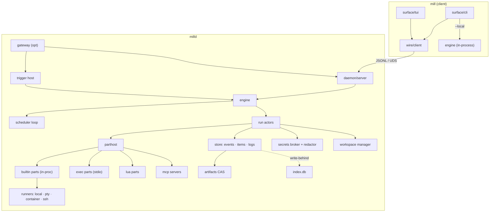
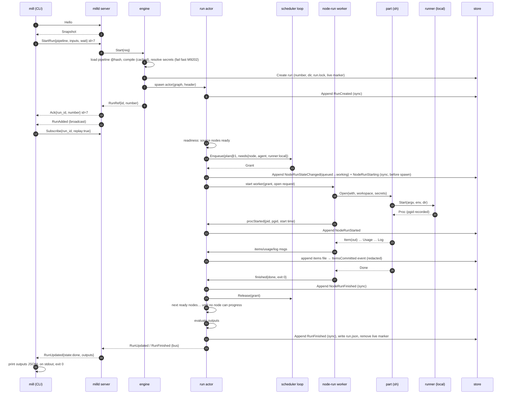
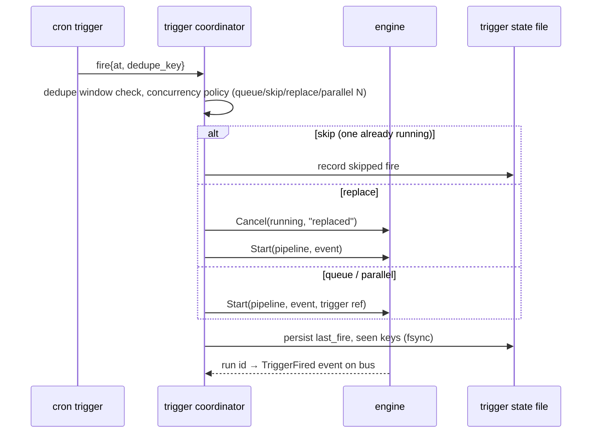

# Architecture

Packages, core interfaces, who owns which goroutine, and how a run moves from trigger to terminal state. Refines spec §5 and §27.4. The layer of every package and the import rules are in [layers.md](layers.md) (the backbone since the 2026-11-12 refinement); citations use the keys in [references.md](references.md).

## 1. Shape in one paragraph

The engine is a **library** (`internal/engine`) that takes a compiled pipeline, a run store, a part host and a clock, and executes runs. `milld` wraps it with a socket server, a trigger host, config reload and an index. `mill run --local` (and the weekend prototype) links the same engine in-process with no socket. Every run is owned by one **run actor** goroutine that is the only writer of that run's event log; every concurrency slot is owned by one **scheduler loop** goroutine. Parts, built-in or external, talk to the engine through the same message set ([protocols.md](protocols.md)); built-ins just skip the JSON.



## 2. Package layout

Refines §27.4. Changes from the spec's layout, with reasons:

- `engine/` is new and holds the run actor, scheduler, slots, budgets, retries and cache. The spec spread these across `daemon/sched`; they must not depend on the daemon, because `--local` and the prototype use them.
- `store/`, `runner/`, `workspace/`, `secrets/`, `trigger/` move out of `daemon/` for the same reason. `daemon/` keeps only what exists because there's a daemon: server, boot wiring, reload, status file.
- The pipe-expression parser moves from `surface/pipe` to `pipeline/pipe`: it's a compiler front end, and `Compile` intents run it in the daemon.
- `errs/` is new: the §29 error object, codes, classes, explain pages. Every layer imports it.
- `core/` is new: plain data types shared by everything (ids, states, items, refs). No logic beyond validation and the pure reducer in `core/fold`.
- 2026-11-12 refinement ([layers.md](layers.md), D31–D33): the event catalog and the reducer move to `core/event` and `core/fold` so the index can rebuild without importing the engine; three L0 leaves leave higher directories (`lock`, `proc`, `redact`); the runner interface moves into `partproto`; `metrics`, `assemble` and `archtest` are new. The right-hand column is the layer.

```
cmd/
  mill/                 main: dispatch to surface/cli                                          L7
  milld/                main: daemon/boot.Run                                                   L7
internal/
  errs/                 Error{Code,Class,Message,Where,Suggestions,Help,Retryable,Cause}, codes, explain/*.md, exit codes   L0
  clock/                Clock interface (real, fake): every timer goes through it               L0
  paths/                config/data/state/runtime dirs, socket path, MILL_* overrides, CheckRoot L0
  mlog/                 slog to file (from rex rexlog), rotation, redacting handler             L0
  version/              Version (ldflags), build info, milestone.txt for the layer ratchet      L0
  metrics/              counters, gauges, histograms; snapshot for Stats (new, D35)             L0
  lock/                 daemon.lock, run.lock (from rex; was store/lock, D33)                   L0
  proc/                 process groups and kill per OS, Identity (was runner/proc, D33)         L0
  redact/               streaming value redactor, argv redaction (from rex; was secrets/redact, D33)   L0
  wire/jsonl/           envelope + codec (from rex), shared by daemon and parts protocol        L0

  core/                 ids, State + transition table, Item, FileRef, WorkspaceRef, Usage, Budget, selectors   L1
  core/event/           event catalog structs, log_v, decoders per version (new, D31)           L1
  core/fold/            pure reducer Apply(RunState, Event); ledger fold (new, D31)              L1
  partproto/            parts protocol messages; Part/Session/Emitter; HostServices incl. the runner
                        contract (Runner, ProcSpec, Proc; moved from runner, D33); loopback; conformance   L1
  wire/protocol/        daemon intents/events payload structs, protocol error codes, Hello/Snapshot   L1

  expr/                 CEL env, ${{ }} template scanner, helpers, secret handle type, cost limits   L2
  schema/               output shorthand → JSON Schema, validator wrapper, error mapping        L2
  pipeline/             Source, Spec (positions), Parse, Lint, InferEdges, Compile(src, Resolver) → ir   L2
  pipeline/ir/          immutable compiled graph (Graph, Node, Edge, Port, PartRef)              L2
  pipeline/pipe/        pipe-expression lexer/parser → Spec                                     L2
  pipeline/edit/        every edit operation and quick fix (CLI, daemon, TUI)                   L2
  pipeline/yamledit/    text-splice YAML edits under pipeline/edit                              L2
  pipeline/layout/      layered DAG layout for render/editor (sidecar read/write)               L2

  store/                RunStore: run dirs, events.jsonl appender (group commit), items, logs, run.json, live markers   L3
  store/cas/            content-addressed artifact store (sha256), materialization, walk for GC L3
  store/index/          SQLite schema, write-behind indexer, queries, rebuild via core/fold     L3

  engine/               Engine, run actor, readiness, outputs, recovery, bus; ports PartSource, SecretResolver,
                        Workspaces, Runners, Sink                                               L4
  engine/sched/         scheduler loop, ready queue, slot pools, priority/aging, breaker holds  L4
  engine/budget/        limits, warnings (ledger fold lives in core/fold)                       L4
  engine/retry/         policy parsing (exp/linear/fixed), matchers, backoff with jitter        L4
  engine/cache/         key derivation (canonical JSON), lookup/store                           L4
  runner/               runner registry, selection, per-runner caps                             L4
  runner/local/ runner/pty/ runner/container/ runner/ssh/                                       L4
  workspace/            git worktrees, temp dirs, cleanup, snapshot/reset for retries, path safety   L4
  secrets/              Broker, grants, backends (env, keychain, op, vault, agefile)            L4

  parthost/             registry + resolution order, part pool, health pings, MCP servers, PartCall;
                        implements pipeline.Resolver and engine.PartSource                     L5
  parthost/luapart/     Lua parts adapted to partproto.Part                                     L5
  parts/builtin/        sh exec check lua map filter reduce sort uniq take skip batch merge split jq template parse
                        if switch loop assert handoff wait pipeline fail noop
                        agent agent.fanout agent.judge agent.review agent.loop agent.extract
                        git.worktree git.commit git.push git.diff gh.pr gh.issue gh.comment
                        http mcp file.* stdin stdout notify (n8n.call, zapier.call later)       L5
  agents/               registry (merge by id), argv builder, headless output parsers, error normalization, usage   L5
  agents/detect/        terminal-agent state detection (regex/idle/hooks), auto_answer          L5
  drafter/              wizard describe drafter: Ollama client, ResolveModel, health, prompt + output guard,
                        keyword fallback (ADR-047)                                              L5
  trigger/              Host: arm/disarm, concurrency policy, dedupe, persistent trigger state  L5
  trigger/cron/ trigger/poll/ trigger/runevent/ trigger/fswatch/ trigger/webhook/ trigger/githook/ trigger/once/   L5
  config/               layered loading, immutable Snapshot, reload, --why                      L5
  config/settings/      settings registry (from rex types), settings.lua writer                 L5
  luaapi/               mill.* API (config phase, runtime phase), sandbox profiles, hooks dispatcher, LuaLS types   L5
  plugins/              manifest, resolver, installer, lockfile, permissions, pack, import/export (M9+)   L5
  wire/client/          dial, Hello, Do(ctx, intent) → reply, event stream                      L5
  daemonctl/            spawn/find/reach milld (from rex)                                       L5
  runner/remote/ runner/external/   (M10) speak to another milld or a plugin                    L5

  daemon/server/        socket listener, conns, handlers (intent → engine/store calls)          L6
  daemon/boot/          wiring: lock, config, recovery, engine, triggers, server, status file, signals   L6
  daemon/status/        tiny status file for `mill prompt` / completion                         L6
  gateway/              HTTP + WebSocket front door (webhooks, remote API) (M7+)                L6
  assemble/             shared wiring: config.Snapshot → engine + adapters (new, D32, M2)       L6

  surface/cli/          subcommands; surface/cli/core output kit (from rex)                     L7
  surface/cli/local/    --local and offline entry: the one surface package that reaches execution (via assemble)   L7
  surface/tui/          splash, board, run popup, editor (canvas/, editor/, settings/) (out of scope here)   L7
  surface/sound/        soundsets, mixer, silent fallback                                       L7
  surface/mcpserver/    `mill mcp serve` (a surface for MCP clients, through wire/client)       L7
  testutil/             testenv, golden, fakeclock helpers, fake parts, echo agent, fake CLIs   T
  archtest/             layer checker over `go list` (layers.md §8.1)                           T
sdk/go/                 parts SDK (separate module; imports nothing from mill) — later ts/, python/
third_party/vt10x/      rex fork (imported as github.com/hinshun/vt10x via replace)             L0
examples/               example pipelines (integration tests)
```

## 3. Dependency direction

Replaced by [layers.md](layers.md): eight layers (L0 platform, L1 domain and contracts, L2 language, L3 persistence, L4 execution, L5 integration, L6 service, L7 surface), ports declared in the consuming layer, composition only in `daemon/boot`, `assemble` and `surface/cli/local`, and the exact `archtest`, depguard and forbidigo rules that enforce it in `make check` [FSA ch. 10] [CA ch. 22] [BEA ch. 4].

The four rules that used to be listed here still hold and are now checked by machine:
1. `engine` sees parts only through `partproto.Part` (via its `PartSource` port); it never imports `parts/builtin` or `parthost` (archtest A2).
2. `parts/builtin/*` never import `engine`, `store`, `runner`, `workspace` or `secrets`; everything arrives through `OpenRequest` and `HostServices` (A6).
3. `surface/tui` never reads run directories; it goes through the daemon. Offline reads (`mill runs --store`, `mill logs` with the daemon down) go through `surface/cli/local` (A3).
4. Only `daemon/boot`, `assemble` and `surface/cli/local` construct an `engine.Engine` (A14 and forbidigo).

## 4. Core interfaces

Go sketches. Names are the plan; signatures may change during M1 but the ownership rules may not.

### 4.1 Shared data (`core`)

Value types with no behavior beyond validation: the domain's vocabulary, isolated from storage and processes [DDD ch. 4]. Money is integer micro-USD.

```go
package core

type RunID string      // 32 lowercase hex chars, random
type NodeRunID string  // "<node>@<attempt>" or "<node>[<i>]@<attempt>", unique within a run

type State string // pending queued working retrying done failed skipped cached cancelled crashed

func (s State) Terminal() bool
func CanTransition(from, to State) bool // table in core/states.go; reducer rejects anything else

type Item struct {
	Data  json.RawMessage `json:"data"`
	Files []FileRef       `json:"files,omitempty"`
	WS    *WorkspaceRef   `json:"ws,omitempty"`
	Meta  ItemMeta        `json:"meta"`
}

type ItemMeta struct {
	ID      string    `json:"id"`      // "<node-run>/<port>/<index>", e.g. "plan@1/out/0"
	Run     RunID     `json:"run"`
	Node    string    `json:"node"`
	Port    string    `json:"port"`
	Index   int       `json:"index"`
	Parents []string  `json:"parents,omitempty"`
	TS      time.Time `json:"ts"`
}

type FileRef struct {
	Name   string `json:"name"`
	Path   string `json:"path,omitempty"` // local read-only view; filled at delivery, never stored
	SHA256 string `json:"sha256"`
	Size   int64  `json:"size"`
	MIME   string `json:"mime,omitempty"`
}

type WorkspaceRef struct {
	ID     string `json:"id"`
	Kind   string `json:"kind"` // git | dir | volume
	Path   string `json:"path"`
	Repo   string `json:"repo,omitempty"`
	Branch string `json:"branch,omitempty"`
	Base   string `json:"base,omitempty"` // commit sha at creation
}

type Usage struct {
	TokensIn, TokensOut, TokensCache int64
	CostMicroUSD                     int64 // integers only; floats never touch money
	Model                            string
}
```

### 4.2 Parts (`partproto`)

The engine is a microkernel and parts are its plug-ins [FSA ch. 12]; this contract is a published language [DDD ch. 14]. One interface for every node, trigger, sink and runner part. Built-ins implement it in Go; the stdio transport implements it by speaking JSONL to a process; the Lua host implements it with a Lua state.

```go
package partproto

type Part interface {
	Describe(ctx context.Context) (Manifest, error)
	Open(ctx context.Context, req OpenRequest, out Emitter) (Session, error)
}

// Session is one context (node-run, trigger arm, sink attach).
type Session interface {
	Item(ctx context.Context, port string, it core.Item) error // host → part input; may block (backpressure)
	EndOfInput(ctx context.Context) error
	Cancel(reason string)                                       // non-blocking; part must Fail(cancelled) within grace
	Resume(ctx context.Context, checkpoint json.RawMessage) error
	Close() error
}

// Emitter is part → host. Safe for concurrent use. Item blocks when the host applies backpressure.
type Emitter interface {
	Item(port string, it core.Item) error
	Log(level slog.Level, msg string, attrs ...slog.Attr)
	Progress(pct float64, msg string)
	Usage(u core.Usage)
	Artifact(name string, r io.Reader, mime string) (core.FileRef, error)
	Checkpoint(data json.RawMessage)
	Done(d DoneInfo)
	Fail(f Failure)
}

type OpenRequest struct {
	Context   ContextInfo        // run, node, node-run, attempt, item index, dry_run
	Capability string            // e.g. "node:sh"
	With      json.RawMessage    // resolved config (expressions evaluated; secret fields are handles)
	Workspace *core.WorkspaceRef
	Secrets   SecretGrant        // only declared + referenced names; Reveal(name) for in-proc parts
	Budget    core.BudgetRemaining
	Scratch   string             // per node-run dir, deleted at node-run end unless kept
	Host      HostServices       // in-proc only; nil fields over stdio
}

// HostServices is what built-ins get instead of importing engine/store.
// Over stdio an external part has the same powers through messages (Artifact, Log, …) or not at all.
// The agent registry is not here: partproto (L1) can't depend on agents (L5). The agent built-ins get
// the run's frozen agents.Registry from parthost when it constructs their Session (layers.md §3 rule 4).
type HostServices struct {
	Runner    Runner          // where to start processes for this node-run (partproto.Runner, §4.3)
	Workspace WorkspaceOps    // create worktree, snapshot, diff
	Expr      Evaluator       // per-item `with` evaluation
	SubRuns   SubRunStarter   // for `pipeline` and `loop`
	Clock     clock.Clock
}

type Failure struct {
	Class     errs.Class
	Code      string        // "M6201" or plugin code "linear/E_TEAM_NOT_FOUND"
	Message   string
	Retryable bool
	RetryAfter time.Duration
	ExitCode  *int
	StderrTail string
}
```

Helpers so a built-in is a handful of lines:

```go
func Batch(fn func(ctx context.Context, c *NodeCtx, in []core.Item) ([]Out, error)) Part
func Each(fn func(ctx context.Context, c *NodeCtx, it core.Item) ([]Out, error)) Part
func Stream(fn func(ctx context.Context, c *NodeCtx, in <-chan core.Item, out Emitter) error) Part
```

### 4.3 Runners (contract in `partproto`, implementations in `runner/*`)

The interface lives in `partproto` (L1) so `HostServices.Runner` needs nothing above L1; `runner` (L4) keeps selection and caps, and `runner/local`, `runner/pty`, … implement it (D33).

```go
package partproto // runner contract (moved from package runner, D33)

type Runner interface {
	ID() string
	Caps() Caps // pty, network control, volume mounts, remote paths
	Start(ctx context.Context, spec ProcSpec) (Proc, error)
}

type ProcSpec struct {
	Argv      []string          // never contains secret values (lint + runtime check)
	Dir       string
	Env       []string          // secrets arrive here, by name the node declared
	Stdin     io.Reader         // nil = /dev/null
	PTY       *PTYSize          // non-nil → terminal mode
	Workspace *core.WorkspaceRef
	Limits    Limits            // cpu, mem, pids (container); wall handled by engine
	Network   string            // "", "none", "default"
	Labels    map[string]string // run/node ids for ps, container labels
}

type Proc interface {
	PID() int
	Stdin() io.WriteCloser
	Stdout() io.Reader          // PTY: merged screen bytes
	Stderr() io.Reader          // nil in PTY mode
	Screen() Screen             // PTY only: vt10x mirror for detection and repaint
	Resize(cols, rows uint16) error
	Interrupt() error           // SIGTERM to group / CTRL_BREAK
	Kill() error                // SIGKILL to group / TerminateJobObject; idempotent
	Wait() (ExitStatus, error)
	Identity() proc.Identity    // pgid + start time (proc is L0), recorded before Start returns for crash recovery
}
```

### 4.4 Triggers, secrets, sinks, artifacts

```go
package trigger

type Trigger interface {
	// Arm blocks until ctx ends, calling fire for each event. State is persisted by the host
	// (last fire time, seen keys) and handed back on re-arm.
	Arm(ctx context.Context, spec Spec, state State, fire func(Fire) error) error
}

type Fire struct {
	Event     json.RawMessage
	DedupeKey string
	At        time.Time
	Reply     chan<- WebhookReply // webhook "wait" mode only
}
```

```go
package secrets

type Backend interface {
	Name() string
	Get(ctx context.Context, name, ref string) (Value, error) // errs M9202 when missing
}
type Setter interface{ Set(ctx context.Context, name string, v []byte) error } // optional
type Value struct{ b []byte }                                                  // String() == "•••"; no JSON marshal
func (v Value) Reveal() []byte                                                 // only Broker and grants call it
```

```go
package engine

// Sink receives run events after they're durable. Delivery is async through a bounded queue;
// a full queue drops and counts (spec §2.10: optional never blocks core).
type Sink interface {
	Name() string
	Deliver(ctx context.Context, ev event.Event) error // event is core/event (D31)
}
```

```go
package cas

type Store interface {
	Put(ctx context.Context, r io.Reader, name, mime string) (core.FileRef, error) // stream-hash, dedupe, atomic
	Open(ctx context.Context, sha string) (io.ReadCloser, error)
	Materialize(ctx context.Context, ref core.FileRef, dir string) (string, error) // read-only hardlink or copy
	Stat(sha string) (int64, bool)
	Remove(sha string) error
	Walk(fn func(sha string, size int64, mtime time.Time) error) error
}
```

### 4.5 Run store and index

```go
package store

type RunStore interface {
	Create(ctx context.Context, h RunHeader) (Run, error) // allocates number, dir, run.lock, live marker
	Open(id core.RunID, mode OpenMode) (Run, error)       // ReadOnly for clients, Owner for the actor/recovery
	Live() ([]core.RunID, error)                          // from live/ markers
	Dir() string
}

type Run interface {
	Append(ev Event, durability Durability) (seq uint64, err error) // owner only; Sync waits for fsync
	Items(nr core.NodeRunID, port string) ItemFile                  // append (owner) / read+tail (any)
	Log(nr core.NodeRunID, stream string) io.WriteCloser            // redacting writer, owner only
	Events(fromSeq uint64) iter.Seq2[event.Event, error]
	Tail(ctx context.Context, fromSeq uint64) <-chan Event          // for Subscribe replay+follow
	WriteSnapshot(s RunSnapshot) error                              // run.json, atomic rename
	Finish() error                                                  // remove live marker, release run.lock
}

type Index interface {
	Upsert(ctx context.Context, batch []IndexOp) error
	Runs(ctx context.Context, q RunQuery) ([]RunRow, string, error)
	Resolve(ctx context.Context, sel core.Selector) ([]RunRow, error)
	NextNumber(ctx context.Context, pipeline string) (int, error) // BEGIN IMMEDIATE
	Stats(ctx context.Context, q StatsQuery) (StatsResult, error)
	Rebuild(ctx context.Context, rs RunStore, progress func(n, total int)) error
}
```

### 4.6 Engine and scheduler

```go
package engine

type Engine struct{ /* … */ }

func New(cfg Config) (*Engine, error) // Store, Index, PartHost, Secrets, Workspaces, Runners, Clock, Settings
func (e *Engine) Start(ctx context.Context, req StartRequest) (RunRef, error)
func (e *Engine) Cancel(id core.RunID, reason string) error
func (e *Engine) Delete(ctx context.Context, id core.RunID) error
func (e *Engine) Recover(ctx context.Context) (RecoveryReport, error)
func (e *Engine) Subscribe(f Filter) (<-chan Update, func()) // live updates for server/CLI
func (e *Engine) Feed(id core.RunID, items []core.Item, end bool) error // streaming stdin input
func (e *Engine) Shutdown(ctx context.Context) error // stop granting slots; live node-runs handled per execution.md §8

package sched

type Request struct {
	Run      core.RunID
	NodeRun  core.NodeRunID
	Priority int
	Order    int        // pipeline topological index
	Since    time.Time  // age
	Needs    SlotSet    // global node, agent, runner:<id>, run-agents:<run>, node-concurrency:<run>/<node>
	Grant    chan<- Grant
}

type Scheduler interface {
	Enqueue(r Request)
	Withdraw(run core.RunID, nr core.NodeRunID) // cancel before grant
	Release(g Grant)                             // exactly once per Grant (invariant 7)
	Resize(slot string, max int)                 // settings reload
	Snapshot() Stats                             // queue depth for metrics/TUI
}
```

## 5. Goroutines and ownership

The model, context rules, bounded queues, stall detection and shutdown order are in [concurrency.md](concurrency.md) and [resilience.md](resilience.md) §4. This table is the ownership map [CIG ch. 2] [CIG ch. 4].

| Goroutine | Count | Owns (only writer) | Talks to |
|---|---|---|---|
| `daemon/boot` main | 1 | process lifecycle, signal handling | everything at start/stop |
| server accept loop | 1 | listener | spawns conn goroutines |
| conn reader | 1 per client | that connection's subscriptions | engine, store (read), index (read) |
| conn writer | 1 per client | the socket write side (rex `clientConn`) | bounded queue; slow client dropped |
| **scheduler loop** | 1 | ready queue, all slot counters | run actors via `Grant` channels |
| **run actor** | 1 per live run | `RunState`, the run's `events.jsonl`, `run.json`, item file appends | scheduler, node-run workers, store, bus |
| node-run worker | 1 per working node-run | its part `Session`, its process | emits messages to its run actor's inbox |
| part I/O pumps | 2–3 per process (stdout reader, stdin writer, stderr pump) | pipe ends | node-run worker |
| part pool | 1 per long-lived part process | demux by `ctx` | node-run workers |
| indexer | 1 | `index.db` writes | fed by run actors through a bounded channel |
| event bus | 0 (fan-out under lock, non-blocking enqueue) | subscriber list | conn writers, sinks, Lua dispatcher |
| trigger arm | 1 per armed trigger | that trigger's runtime | trigger coordinator |
| trigger coordinator | 1 | concurrency policy state, dedupe windows, trigger state files | engine.Start/Cancel |
| Lua hook dispatcher | 1 | hook `LState` (rex dispatcher pattern) | engine via `mill.start` etc. |
| sink worker | 1 per sink | its queue | external systems |
| config watcher | 1 | reload debounce | config, parthost, triggers |
| status writer | 1 | status file | bus |
| pipeline watcher | 1 | pipeline catalog | bus (`PipelineChanged`), triggers (re-arm) |

Rules:
1. **One writer per run.** Only the run actor appends to `events.jsonl`. Node-run workers send messages (`partMsg`, `procExited`, `usage`) to the actor's inbox; the actor validates, redacts, persists, folds, then broadcasts. Broadcasting happens after the append returns, so clients never see an event that a crash could lose (for events written with `Sync` durability).
2. **One owner of slots.** The scheduler loop grants and releases. A run actor releases a grant only by sending `Release` when it has folded a terminal state for that node-run; teardown is the only path to a terminal state, so the release can't be skipped (invariant 7). A test asserts all pools are at zero after every engine test (`sched.AssertDrained`).
3. **No locks across components.** Components communicate by channels; the few mutex-protected structures (bus subscriber list, part registry snapshot, settings snapshot) are copy-on-write and never held while calling out.
4. **Blocking budget.** A run actor never blocks on I/O other than its own local disk appends. Slow things (process spawn, git worktree creation, secret resolution through `op`) run in node-run workers or short-lived helper goroutines that report back.
5. **Context tree.** `daemon ctx → engine ctx → run ctx → node-run ctx → process`. Cancel uses explicit teardown messages, not just ctx cancellation, so the grace period and drain happen (invariant 8). ctx cancellation is the last resort at shutdown.
6. **goleak clean.** Every component has a `Close`/`Shutdown` that returns only after its goroutines exit. Tests run with goleak via `testenv.RunLeakChecked`.

## 6. Lifecycle of a run

### 6.1 States

Run: `queued → working → done | failed | cancelled | crashed`. Node-run: see [engine.md](engine.md) §4 for the full table. Transitions are validated by `core.CanTransition` inside the reducer; an illegal transition is an `M0xxx` internal error and the event is not written.

### 6.2 From `mill run` to result (daemon mode)



### 6.3 Trigger to run



`queue` policy holds pending fires in the coordinator (persisted), not in the engine, so a long queue never creates `queued` runs that eat run slots and so a restart keeps the queue.

### 6.4 Cancel and teardown

```mermaid
sequenceDiagram
  participant C as client
  participant A as run actor
  participant W as worker
  participant P as part/process
  participant Q as scheduler
  C->>A: CancelRun(reason)
  A->>A: Append RunCancelRequested; stop enqueuing; Withdraw queued requests
  loop each working node-run
    A->>W: teardown(reason)
    W->>P: Cancel (protocol) + Interrupt (SIGTERM group / CTRL_BREAK)
    alt exits within grace (default 10s)
      P-->>W: Fail{class: cancelled} or exit
    else
      W->>P: Kill (SIGKILL group / TerminateJobObject)
    end
    W->>W: drain stdout/stderr ≤ 2s or 1 MiB
    W->>A: finished{cancelled}
    A->>A: Append NodeRunFinished(cancelled) — never failed
    A->>Q: Release
  end
  A->>A: workspace cleanup per policy
  A->>A: Append RunFinished(cancelled, reason)
```

### 6.5 Daemon restart

```mermaid
sequenceDiagram
  participant B as boot
  participant L as daemon.lock
  participant S as store
  participant E as engine
  B->>L: acquire (fail M7xxx if held)
  B->>S: Live() → run ids
  loop each live run
    B->>S: try run.lock (skip if held by a --local process)
    B->>S: replay events → RunState (truncate torn tail)
    B->>E: Recover(run)
    E->>E: per node-run: queued/pending → requeue; working → kill orphan group if same identity, then resumable→Resume, idempotent→new attempt, else crashed (M4301)
  end
  B->>B: start server, arm triggers (missed cron per catch_up)
```

## 7. Process model details

| Process | Started by | Lifetime | Group / job |
|---|---|---|---|
| `milld` | `daemonctl.Start` (detached: setsid / new process group + hidden console), or by the user, or launchd/systemd unit (later) | until `Shutdown` or signal | own session |
| step process (sh, exec, check, headless agent) | runner/local | node-run | own process group (Unix `Setpgid`), own Job Object (Windows) |
| terminal agent | runner/pty | node-run | own session (creack/pty uses `Setsid`), Job Object on Windows |
| executable part (per-call) | parthost | one context | own process group |
| executable part (long-lived) | parthost | until idle timeout (default 5 min) or failed `Ping` | own process group |
| MCP server | parthost | long-lived, restarted on failure with backoff | own process group |
| container | runner/container via `docker`/`podman` CLI | node-run | `--rm`, labeled `mill.run=<id>` so recovery can find and kill it |

Only `milld` (or the `--local` process) ever spawns children. The `mill` client spawns only `milld` and, for `mill edit`, `$EDITOR`.

## 8. Configuration flow

Detail (layers, validation phases, apply modes, trust-widening keys) in [configuration.md](configuration.md).

1. `config.Load(layers)` evaluates Lua layers in order (spec §19.2) into a `config.Snapshot` (settings, agents, MCP servers, runners, secret backends, plugin specs, hooks as Lua function refs).
2. The snapshot is immutable. Reload builds a new one; on error the old one stays and the error is published (`config_error` on the bus, M8xxx).
3. Consumers subscribe and apply: scheduler resizes pools, parthost diffs MCP/runner definitions, trigger host re-arms only changed triggers. Running runs keep the snapshot they started with for agent registry and runner definitions (invariant 10 extended to config): the run header records the config snapshot hash.
4. The client loads the same layers for TUI settings, keymaps and themes, with runtime-only API calls (`mill.on`, `mill.command` bodies) recorded but not executed.

## 9. Sources

| Decision | Section | Follows |
|---|---|---|
| Engine as a library hosted by `milld` and `--local` | §1 | [FSA ch. 12] [CA ch. 26] |
| Layers and dependency rule | §2–3 | [FSA ch. 10] [CA ch. 22] [DDD ch. 4]; detail in [layers.md](layers.md) |
| Domain value types in `core` | §4.1 | [DDD ch. 4] |
| One part contract for built-ins and external parts | §4.2 | [FSA ch. 12] [DDD ch. 14] [TAOUP ch. 7] |
| Accept interfaces, declared by the consumer | §4 | [LG ch. 7] [CA ch. 11] |
| Sinks as async, droppable taps | §4.4 | [EIP, Wire Tap] [RI ch. 5, Bulkheads] |
| CAS with dedupe and atomic rename | §4.4 | [EIP, Claim Check] [DDIA ch. 3] |
| Run store as append-only log with derived index | §4.5 | [DDIA ch. 11] [DDIA ch. 12] |
| One writer per run, one owner of slots | §5 | [CIG ch. 4, Confinement] [DDD ch. 6] |
| Lifecycle sequences: write-ahead before spawn, broadcast after append | §6 | [DBI ch. 5] |
| Trigger coordinator holds queued fires | §6.3 | [SRE ch. 24] [EIP, Idempotent Receiver] |
| One teardown path | §6.4 | [BSRS ch. 6] |
| Process groups per step | §7 | [TAOUP ch. 7] [RI ch. 5, Bulkheads] |
| Immutable config snapshot, last-good on reload | §8 | [SRW ch. 14] |
