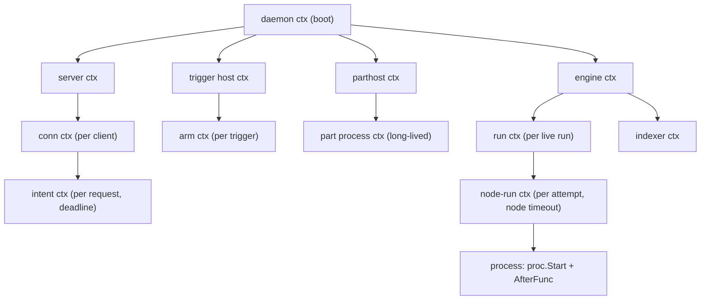

# Concurrency model

Status: review (2026-11-12 refinement, awaiting the user). Refines [architecture.md](architecture.md) §5 (the goroutine and ownership table stays there).

How goroutines are owned, how cancellation flows, how `context` is used, and how leaks and stalls are prevented. Layers per [layers.md](layers.md).

## 1. Model

mill uses communicating sequential processes: state is owned by one goroutine and changed by messages, not shared under locks [CIG ch. 2]. Two goroutines own almost everything that matters:

| Owner | Layer | Owns | Why one goroutine |
|---|---|---|---|
| **Run actor** (one per live run) | L4 `engine` | `RunState`, the run's `events.jsonl`, `run.json`, item appends | One writer makes the event log a total order without locks; it's the run aggregate's root [DDD ch. 6] [CIG ch. 4, Confinement] |
| **Scheduler loop** (one) | L4 `engine/sched` | the ready queue, every slot counter, breaker holds | Grants are atomic across pools without partial holds or lock ordering |

Everything else (node-run workers, part I/O pumps, connection readers and writers, trigger arms, the indexer, sinks) is a helper that reports to an owner through a channel.

Read-mostly shared state (settings snapshot, part registry snapshot, bus subscriber list) is **copy-on-write**: an `atomic.Pointer` to an immutable value, swapped whole on change. Readers never lock; writers build a new value and swap [CIG ch. 3].

## 2. Goroutine rules

1. **Every `go` statement has an owner** that can stop it and waits for it [CIG ch. 4, Preventing Goroutine Leaks]. Owners use `errgroup.Group` (`golang.org/x/sync`) or a `sync.WaitGroup` plus a stop channel. Fire-and-forget goroutines are a review blocker.
2. **Every owner has `Close`/`Shutdown`** that returns only after its goroutines have exited.
3. **Every blocking operation has a way out:** a `select` on `ctx.Done()` (or the owner's stop channel) next to every channel send and receive that could block, and a deadline on every I/O [CIG ch. 4, or-done]. The one exception is the run actor's own local-disk append, which is bounded by fsync time and measured ([performance.md](performance.md)).
4. **Bounded channels only.** Every channel has a fixed capacity and a documented overflow behavior: block (backpressure), drop and count, or disconnect. The inventory lives in [resilience.md](resilience.md) §4. An unbounded queue is a review blocker [RI ch. 4, Unbounded Result Sets] [SRE ch. 22].
5. **No locks held across calls into another component.** A mutex protects one structure inside one package and is released before any call out, channel send or I/O.
6. **The run actor never blocks on anything slow** except its own appends. Spawning, worktree creation, secret backends and network calls run in workers or short-lived helpers that report back with a message.
7. **Panics** are recovered only at helper-goroutine boundaries and converted to errors for the owner ([errors.md](errors.md) §4). Owner goroutines don't recover.

## 3. Context

Rules from [LG ch. 14] and [CIG ch. 4, The context Package]:

- `context.Context` is the first parameter of anything that blocks or does I/O, all the way down to L0 (`proc.Start`, `cas.Put`, `secrets.Backend.Get`).
- Contexts carry **cancellation and deadlines only**. No dependencies in context values; the only values allowed are a request id and a trace id used by logging (`mlog.With(ctx)`).
- A context is never stored in a struct, except an owner's base context created at construction and cancelled by `Close`.
- `context.AfterFunc` (Go 1.21+) is used to tie a non-context resource (a process, a pipe) to a context's end in one place.
- Deadlines come from the table in [resilience.md](resilience.md) §2; nothing calls out without one.

### 3.1 The context tree

Two kinds of stop travel down this tree, in this order:

1. **Teardown messages** (explicit): cancel, delete, budget, `max_wall`, timeout and fail-fast send `teardown(reason)` to the run actor, which drives the grace-then-kill sequence ([engine.md](engine.md) §9). This is how invariant 8 holds: the actor knows it is `cancelling`, so a killed process's exit code is never read as a failure.
2. **Context cancellation** (implicit): the last resort at shutdown and the safety net under every helper. When a node-run's ctx ends without a teardown (daemon shutdown), the process is left to the recovery rules ("stopping the daemon is a crash", ADR-042).

The node-run ctx carries the node `timeout` as its deadline. When it fires, the worker reports `timeout` to the actor, which then runs the same teardown with class `timeout` (M4201).

### 3.2 Cancellation across process boundaries

| Boundary | Signal sent | Then |
|---|---|---|
| engine → part (protocol) | `Cancel{grace_ms}` on the context | part must `Fail{cancelled}` within grace |
| engine → process | `proc.Interrupt` (SIGTERM to the group, CTRL_BREAK on Windows; PTY agents get `exit_keys` first) | `proc.Kill` after grace; drain ≤ 2 s or 1 MiB |
| client → daemon | `CancelRun` intent | `Ack` means requested, not finished; the client follows `RunUpdated` |
| `mill run --local` → engine | SIGINT/SIGTERM → `Engine.Cancel(run, "signal")` | second signal → hard exit; recovery applies later |

## 4. Shutdown order

`daemon/boot` stops components in reverse start order, each `Close` waiting for its goroutines [RI ch. 13]:

1. Stop accepting connections; intents that arrive now get `Error{bad_state}` with an `unreachable`-class error object, so clients retry against the next daemon.
2. Disarm triggers (persist trigger state, fsync).
3. `Engine.Shutdown`: stop granting slots; with `--drain`, wait for working node-runs up to `shutdown.drain_timeout`; otherwise leave them (crash semantics, ADR-042).
4. Flush the indexer (bounded by 2 s; anything left is re-folded on start).
5. Stop sinks (drop queued deliveries, count them), the Lua dispatcher, the config watcher.
6. Close part processes (`Shutdown` message, then kill after 2 s).
7. Close connections, release `daemon.lock`, close `mlog`.

A test starts a daemon with a run in every state, shuts it down, and asserts goleak-clean exit within 5 s.

## 5. Stall detection (heartbeats)

Owners that must never stop moving publish a heartbeat [CIG ch. 5, Heartbeats]:

| Goroutine | Beat | Stalled when | Then |
|---|---|---|---|
| scheduler loop | each pass and every 1 s idle | no beat for 5 s | `milld.log` error with the goroutine stack, `stalls_total{component}` metric, `mill doctor` shows it |
| run actor | each inbox message and every 1 s idle | no beat for 10 s while live | same; the run's board text says `stalled · see mill doctor` |
| indexer | each batch | queue non-empty and no beat for 10 s | same; runs re-fold on next start |
| conn writer | each write | covered by the 5 s write deadline | client dropped |

A stall is a bug, so the response is to make it visible, not to restart the goroutine (restarting an actor would risk two writers).

## 6. Time

- All timers and `now` reads go through `clock.Clock` (forbidigo rule, [layers.md](layers.md) §8.3). Durations use the monotonic reading; event `ts` uses wall time in UTC [DDIA ch. 8].
- `core/fold` never reads time; it uses event timestamps, so replay is deterministic.
- Tests use the fake clock for pure timer logic and `testing/synctest` bubbles for goroutine-heavy tests (scheduler, retries, cron), so a 5-minute backoff runs in microseconds.
- `max_wall` counts active time (ADR-044 / D16): the actor accumulates monotonic time while it runs, and a clock jump or sleep doesn't spend it.

## 7. Tests

| Test | Guards |
|---|---|
| goleak in every `TestMain` (`testenv.RunLeakChecked`) | rule 1 |
| `go test -race` always ([testing.md](testing.md)) | data races |
| `sched.AssertDrained` after every engine test | invariant 7 |
| `TestShutdown_AllStates_NoLeaks` | §4 |
| `TestStall_SchedulerReported` with a fake blocked pool | §5 |
| Nightly `-count=50 -race` on `engine/**`, `store/**` | rare interleavings |
| `TestTeardown_ExitCodeIgnored` (`@echo:ignore-term`, `@echo:spawn-child`) | invariant 8, §3.2 |

## 8. Sources

| Decision | Follows |
|---|---|
| Owner goroutines and messages instead of shared locks | [CIG ch. 2] [CIG ch. 4, Confinement] |
| Run actor as the aggregate root | [DDD ch. 6] |
| Copy-on-write snapshots for read-mostly state | [CIG ch. 3] |
| Every goroutine owned and stoppable | [CIG ch. 4, Preventing Goroutine Leaks] |
| Context for cancellation and deadlines only | [LG ch. 14] [CIG ch. 4] |
| Bounded channels with explicit overflow | [RI ch. 4] [SRE ch. 22] |
| Errors and panics delivered to the owner | [CIG ch. 5, Error Propagation] |
| Heartbeats for stall detection | [CIG ch. 5, Heartbeats] |
| Monotonic durations, wall-clock stamps | [DDIA ch. 8] |
| Ordered shutdown, drain on demand | [RI ch. 13] |
