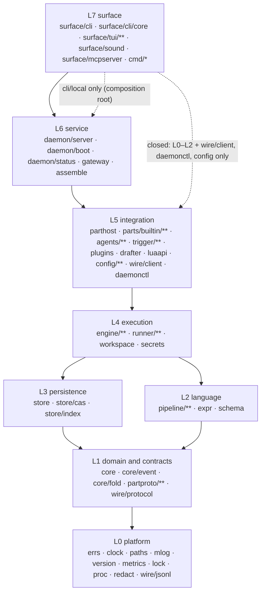

# Layers

Status: accepted (2026-11-12, ADR-054; its choices are D31–D41 in [open-decisions.md](open-decisions.md)). Spec: [§5](../../spec/05-architecture.md#5-architecture), [§27.4](../../spec/27-tech-stack.md#274-repository-layout).

The backbone of the backend plan. It sorts every package into one of eight layers, says what each layer owns, what it may import, which interfaces it publishes, which invariants it keeps, how its failures are contained and how it is tested, and gives the exact CI checks that keep the layering true. Every other backend file refers to these layer names (L0–L7).

Citations use the keys in [references.md](references.md).

## 1. Why layers, and which kind

mill is two local binaries built from one Go module. The style that fits is a **layered monolith with a microkernel core** [FSA ch. 10] [FSA ch. 12]: technical layers from OS plumbing up to the screen, and inside the execution layer a small engine that knows parts only through one contract (principle 7, "everything is a part").

Four rules shape the layering:

1. **Dependencies point down, toward policy** [CA ch. 22]. A package may import packages in its own layer or below, never above. The domain (L1) is isolated from storage, processes and screens [DDD ch. 4].
2. **Ports are declared low, adapters live high, the top wires them** [CA ch. 11] [LG ch. 7]. When a lower layer needs something from a higher one (the engine needs a part host, the compiler needs to resolve `uses`), the lower layer declares a small interface and the higher layer implements it. Concrete types meet only in a composition root [CA ch. 26].
3. **Open layers by default, closed at the surface** [FSA ch. 10]. A layer may import any lower layer (open), which avoids the architecture sinkhole antipattern where every call passes through layers that add nothing. The surface (L7) is closed: it reaches the engine only through the daemon or through one named composition root.
4. **Checked by machines, not by review** [BEA ch. 2] [BEA ch. 4]. The rules are fitness functions that fail `make check` (§8). Exceptions are listed by name with a removal milestone, and the list may only shrink.

## 2. The layers at a glance



An arrow means "may import". Layers are open: L5 may import L4, L3, L2, L1 and L0. L3 doesn't need L2 and the rules forbid it (§8).

| Layer | Name | Responsibility in one line | May import |
|---|---|---|---|
| **L0** | Platform | OS, time, files, logs, errors, metrics, the JSONL codec: no mill concepts | stdlib, `golang.org/x/sys`, other L0 |
| **L1** | Domain and contracts | What a run, node-run, item and event *are*; the pure reducer; the part and wire contracts | L0 |
| **L2** | Language | Pipeline files and expressions → immutable IR | L0–L1, cel-go, yaml/v4, jsonschema, gojq, doublestar |
| **L3** | Persistence | Run dirs, event log, items, CAS, index | L0–L1, modernc sqlite, klauspost/compress |
| **L4** | Execution | Engine (actor, scheduler, budgets, retries, cache), runners, workspaces, secrets | L0–L3 (engine reaches runners, workspaces, secrets only through its ports) |
| **L5** | Integration | Part host, built-in parts, agents, triggers, plugins, MCP, Lua, config, the drafter, the daemon client | L0–L4 (built-ins: L0–L2 + `agents` + `luaapi` only) |
| **L6** | Service | `milld`: server, boot, status file, gateway; the shared wiring (`assemble`) | L0–L5 |
| **L7** | Surface | CLI, TUI, sound, MCP server, the two `main`s | L0–L2, `wire/client`, `daemonctl`, `config/**`; `surface/cli/local` also `assemble` |

Test support (`testutil/**`) is outside the stack: any test may import it, no production code may (§8).

## 3. Rules

1. **Downward only.** An import from layer *n* to layer *m* > *n* fails CI. Go forbids cycles; the layer rule also forbids "legal" upward imports [CA ch. 14].
2. **Ports in the consumer.** An interface lives in the package that *uses* it, at the lowest layer that needs it [LG ch. 7] [CA ch. 11]. The current ports:

   | Port | Declared in (layer) | Implemented by (layer) |
   |---|---|---|
   | `pipeline.Resolver` (resolve `uses` → `partproto.Manifest`) | `pipeline` (L2) | `parthost` (L5) |
   | `engine.PartSource` (`PartRef` → `partproto.Part`) | `engine` (L4) | `parthost` (L5) |
   | `engine.SecretResolver`, `engine.Workspaces`, `engine.Runners` | `engine` (L4) | `secrets`, `workspace`, `runner` (L4 siblings) |
   | `engine.Sink` | `engine` (L4) | sink parts via `parthost` (L5) |
   | `partproto.HostServices` (`Runner`, `WorkspaceOps`, `Evaluator`, `SubRunStarter`) and `partproto.Emitter` | `partproto` (L1) | `runner/*`, `workspace` (L4), `expr` adapter and `engine` (L4) |
   | `trigger.Starter` (start/cancel a run) | `trigger` (L5) | `engine` (L4), adapted in `assemble` |
   | `luaapi.Host` (`mill.start`, `mill.cancel` from hooks) | `luaapi` (L5) | `engine`, adapted in `assemble` |
   | `drafter.Agent` (fallback drafting through a headless agent) | `drafter` (L5) | `agents` (L5), adapted in `assemble` |

3. **Composition roots.** Only `daemon/boot`, `assemble` and `surface/cli/local` construct concrete adapters and an `engine.Engine` [CA ch. 26]. `assemble` (L6, new, D32) holds the wiring both roots share, so `--local` and `milld` build the engine the same way.
4. **Built-ins get no special internals** (principle 7). `parts/builtin/**` may import L0–L2, `agents/**` and `luaapi` only. Runners, workspaces, sub-runs and the clock reach them through `partproto.HostServices`; secrets through the `SecretGrant`. This keeps every built-in replaceable by an external part [FSA ch. 12].
5. **Config is data.** `config/**` evaluates Lua into an immutable `config.Snapshot`. It never imports the engine, part host, triggers or plugins; consumers receive values from the composition root [SRW ch. 14].
6. **The surface is closed.** `surface/**` talks to the daemon through `wire/client`. The only way it reaches execution is `surface/cli/local`, the `--local` root (D32).
7. **Time, processes, env and stdout are owned.** `time.Now`/timers only through `clock`; child processes are started only by `proc` (runners, `workspace` for `git` and `daemonctl` for `milld` build an `exec.Cmd` and hand it to `proc`); `os.Getenv` only in `paths`, `config`, the `env` secret backend and the env allowlist in `proc`/`runner`; `os.Stdout` only in `surface/cli/core` and `cmd/*`. Enforced by forbidigo (§8.3).
8. **Third-party code by layer.** Each layer has an allowlist of external modules (§8.1). L1 has none; that is what keeps the domain stable [CA ch. 14] [SEG ch. 21].
9. **Directory = layer.** A package's directory decides its layer, so tools can check by path prefix. This moves three L0 leaves out of higher directories (`store/lock` → `lock`, `runner/proc` → `proc`, `secrets/redact` → `redact`) and the runner interface into `partproto` (D33).

## 4. Layer by layer

### L0 Platform

**Responsibility.** Everything that knows about the OS, time and bytes but nothing about pipelines: error values, the clock, paths, logging, version strings, an in-process metrics registry, file locks, process groups, the streaming redactor and the JSONL codec.

| Package | What |
|---|---|
| `errs` | The §29 error object, codes, classes, exit-code map, explain pages (embed). Imports nothing internal |
| `clock` | `Clock` interface, real and fake; monotonic durations, wall-clock stamps [DDIA ch. 8] |
| `paths` | Config/data/state/runtime dirs, socket path and length check (M7002), `MILL_*`/`XDG_*`, `CheckRoot` |
| `mlog` | `slog` handler to a 0600 file, rotation, redacting writer (from rex `rexlog`) |
| `version` | `Version`, build info; separate from protocol and format versions ([versioning.md](versioning.md)) |
| `metrics` (new) | Counters, gauges, fixed-bucket histograms with bounded labels; snapshot for `Stats` ([observability.md](observability.md)) |
| `lock` (was `store/lock`) | `daemon.lock`, `run.lock` (flock / LockFileEx, from rex) |
| `proc` (was `runner/proc`) | Start with a new process group / Job Object, `Interrupt`, `Kill`, `Identity` (pid, pgid, start time), orphan check |
| `redact` (was `secrets/redact`) | Aho–Corasick value redactor, streaming writer, argv redaction (from rex) |
| `wire/jsonl` | Envelope `{v, kind, type, id, ctx, data}` and codec: 16 MiB line cap, sticky errors, resumable reads (from rex) |

- **Public interfaces:** `errs.Error`, `errs.Class`, `errs.New/Wrap/ExitCode`; `clock.Clock`; `paths.Dirs`; `metrics.Registry`; `lock.Lock`; `proc.Proc`, `proc.Identity`; `redact.Redactor`; `jsonl.Reader/Writer`, `jsonl.Envelope`.
- **Invariants:** no package-level mutable state and no `init` side effects; no goroutines that outlive a call except `mlog`'s writer, which `Close` stops; every function that can block takes a `context.Context` or a deadline.
- **Failure modes and containment:** OS errors (permission, ENOSPC, path too long) come back as `errs.Error` with class `user`, `refused` or `transient` and a help line, never a panic. A lock held by another process is a typed error (M7005) naming the holder. A codec line over the cap is sticky and closes only that stream [RI ch. 5, Fail Fast].
- **Tests:** unit and fuzz (`FuzzCodecRead`, `FuzzPathSafety`, `FuzzRedactorChunks`), run on macOS, Linux and Windows because this is where OS differences live. `proc` has integration tests with real process trees (grandchild killed).

### L1 Domain and contracts

**Responsibility.** The vocabulary of mill and the contracts other layers implement. A pure model: no I/O, no clock reads, no goroutines [DDD ch. 4].

| Package | What |
|---|---|
| `core` | `RunID`, `NodeRunID`, `State` and the transition table, `Item`, `FileRef`, `WorkspaceRef`, `Usage`, `Budget`, selectors |
| `core/event` (new, D31) | The event catalog as Go structs (`RunCreated`, `NodeRunStarting`, …), `log_v`, the event envelope; decoders for every shipped `log_v` |
| `core/fold` (new, D31) | `Apply(RunState, Event) (RunState, error)`: the pure reducer used live, on recovery and by index rebuild; budget ledger fold |
| `partproto` | Parts protocol messages; `Part`, `Session`, `Emitter`, `OpenRequest`, `Manifest`, `Failure`; `HostServices` with the runner contract (`Runner`, `ProcSpec`, `Proc`, moved here from `runner`, D33) |
| `partproto/loopback` | In-process `Part` over a pipe pair and the real codec |
| `partproto/conformance` | Test kit: runs any `Part` through direct and loopback paths and compares |
| `wire/protocol` | Daemon intents and events as structs, protocol error codes, `Hello`/`Snapshot` |

- **Public interfaces:** the types above; `core.CanTransition`; `fold.Apply`; `partproto.Part`; `wire/protocol` message structs. These are mill's **published languages** [DDD ch. 14]: the event log, the parts protocol and the wire protocol are what other programs and older versions read.
- **Invariants:** invariant 6 (terminal states never change) lives in `core.CanTransition` and is enforced by `fold.Apply`, which rejects an illegal transition with an internal error; `fold.Apply` is deterministic (same events in, same state out) because it reads time only from event timestamps; every event type and protocol message evolves additively (principle 12) [DDIA ch. 4].
- **Failure modes and containment:** malformed or out-of-order events return errors to the caller, which decides (the actor refuses to append; recovery marks the run `crashed` with M4302). There is nothing else that can fail here, which is the point: bugs show up as fuzz findings, not as outages.
- **Tests:** property tests over random event sequences (terminal never changes, fold total), `FuzzEventLogReplay` on any byte prefix, golden JSON for every event type and message (a shape change shows up in review), `FuzzPartMessages`, coverage floor 95 % (D39).

### L2 Language

**Responsibility.** Turn pipeline files, pipe expressions and `${{ }}` templates into an immutable compiled graph, with positioned diagnostics.

| Package | What |
|---|---|
| `expr` | CEL environment, `${{ }}` scanner, helpers, the opaque secret handle type, cost limits |
| `schema` | Output shorthand → JSON Schema, validator wrapper, error mapping |
| `pipeline` | `Source`, `Spec` with positions, `Parse`, `Lint`, `InferEdges`, `Compile` (takes a `Resolver`) |
| `pipeline/ir` | `Graph`, `Node`, `Edge`, `Port`, `PartRef`: immutable once built |
| `pipeline/pipe` | Pipe-expression lexer and parser → `Spec` |
| `pipeline/edit` | Every edit operation and quick fix (CLI, daemon and TUI share it; spec §27.4) |
| `pipeline/yamledit` | Text-splice YAML edits under `pipeline/edit` |
| `pipeline/layout` | Layered DAG layout and sidecar for render, editor and run popup |

- **Public interfaces:** `pipeline.Compile(src, Resolver, Options) (*ir.Graph, Diagnostics)`, `pipeline.Resolver`, `expr.Env`, `expr.Template`, `schema.FromShorthand`, `edit.Apply`.
- **Invariants:** `Compile` is a pure function of (bundle bytes, resolver snapshot, options), so its result is cacheable by `(bundle hash, registry hash)` and replay compiles identically (invariant 10); IR is never mutated after `Compile` returns; every diagnostic carries a position and an M2/M3 code.
- **Failure modes and containment:** user mistakes are diagnostics, not errors that stop the process; CEL evaluation is bounded by cost limit and deadline (M3110) and result size (M3111) [BSRS ch. 12]; `@file` loads go through an `fs.FS` rooted with `os.Root`, so a pipeline can't read outside its project.
- **Tests:** table tests per rule, `FuzzPipelineParse`, `FuzzTemplateScan`, `FuzzPipeExpr`, `FuzzYAMLEdit`, golden diagnostics with carets, golden IR dumps for `examples/`.

### L3 Persistence

**Responsibility.** Durable, append-only facts on disk and the rebuildable views over them [DDIA ch. 11] [DDIA ch. 3].

| Package | What |
|---|---|
| `store` | `RunStore`, `Run`: run dirs, `events.jsonl` appender with Sync and Group durability, item files and commit offsets, redacting log writers, `run.json`, live markers |
| `store/cas` | Content-addressed artifacts: stream-hash, dedupe, atomic rename, materialize read-only, walk for GC |
| `store/index` | SQLite schema, write-behind indexer, queries, selectors, `Rebuild` (folds logs with `core/fold`) |

- **Public interfaces:** `store.RunStore`, `store.Run`, `store.Durability`, `cas.Store`, `index.Index` (full sketches in [architecture.md](architecture.md) §4.5).
- **Invariants:** one writer per run (owner mode + `run.lock`); invariant 4 (append-only; corrections are new events); an item line is visible downstream only after an `ItemsCommitted` event recorded its offset; write-ahead: a `Sync` append returns only after fsync [DBI ch. 5]; the index is a cache: deleting `index.db` loses nothing (principle 5).
- **Failure modes and containment:** a torn last line is copied aside and truncated [DBI ch. 3]; corruption before the last line marks that one run `crashed` (M4302) and leaves every other run alone; ENOSPC on an event append stops that run's actor without a terminal event, so recovery handles it like a crash (M2002, [data-lifecycle.md](data-lifecycle.md)); a full indexer queue marks the run `index_dirty` and re-folds later, so SQLite never blocks a run; a corrupt or old-schema index is rebuilt, never migrated [BEA ch. 6].
- **Tests:** crash injection (a store wrapper that fails or panics on the Nth write), torn-write fixtures, file-mode checks, **rebuild equivalence** (index built live == index rebuilt from logs, compared row by row), B2, B3, B6, B9.

### L4 Execution

**Responsibility.** Run compiled graphs: the run actor, the scheduler and its slot pools, budgets, retries, cache and teardown; the places node-runs execute (runners), the workspaces they run in, and the secrets they may use.

| Package | What |
|---|---|
| `engine` | `Engine`, run actor, readiness, outputs, recovery, bus; declares the ports `PartSource`, `SecretResolver`, `Workspaces`, `Runners`, `Sink` |
| `engine/sched` | Scheduler loop, ready queue, slot pools, priority and aging, circuit-breaker holds (D36) |
| `engine/budget` | Limits, warnings, checks (the ledger fold itself is in `core/fold`) |
| `engine/retry` | Retry policy grammar, matchers, backoff with full jitter |
| `engine/cache` | Cache keys (RFC 8785 canonical JSON), lookup, store |
| `runner` | Runner registry and selection, per-runner caps (the interface is `partproto.Runner`) |
| `runner/local`, `runner/pty`, `runner/container`, `runner/ssh` | Runner implementations (M0/M1, M6, M9, M9) |
| `workspace` | Git worktrees, temp dirs, snapshots and resets for retries, diffs, cleanup, path safety |
| `secrets` | Broker, grants, backends (`env`, `keychain`, `1password`, `vault`, `agefile`) |

- **Public interfaces:** `engine.New(Config)`, `Engine.Start/Cancel/Delete/Recover/Subscribe/Feed/Shutdown`, `sched.Scheduler`, `partproto.Runner` implementations, `workspace.Manager`, `secrets.Broker`.
- **Invariants:** the run actor is the aggregate root of a run: the only writer of its log, and every state change goes through it [DDD ch. 6] [CIG ch. 4, Confinement]; invariant 7 (slots released on every path; `sched.AssertDrained`); invariant 8 (one teardown path); invariant 10 (a run keeps its bundle hash and config hash); write-ahead `NodeRunStarting` before any spawn; every outside-world decision is an event before it takes effect, so replay needs no outside world.
- **Failure modes and containment:** a hung child → node `timeout` → teardown with grace then kill [RI ch. 5, Timeouts]; a burst of node-runs → slot pools as bulkheads per resource (global, agents, per agent id, per runner, per run, per node) [RI ch. 5, Bulkheads]; runaway spend → budgets cancel the run [RI ch. 5, Governor]; a provider outage → retries with backoff and a per-agent breaker that holds the queue (D36) [RI ch. 5, Circuit Breaker]; a daemon crash → replay from the log, orphan groups killed by identity, non-idempotent work `crashed`, never silently re-run [RI ch. 5, Let It Crash] [BSRS ch. 9]. Full table: [resilience.md](resilience.md).
- **Tests:** component tests with fake parts, a fake runner, a temp store and `clock` fake or `testing/synctest`; `AssertDrained` in every cleanup; goleak; crash-point exploration over every append; real-process integration for runners and git worktrees.

### L5 Integration

**Responsibility.** Everything that talks to something mill doesn't control: part processes, built-in parts, agent CLIs, MCP servers, plugins, triggers, Lua, the user's config, the local LLM, and (from the client side) the daemon.

| Package | What |
|---|---|
| `parthost` | Part registry and resolution order, process pool, health pings, `ctx` multiplexing, MCP server lifecycle; implements `pipeline.Resolver` and `engine.PartSource` |
| `parthost/luapart` | Lua parts adapted to `partproto.Part` |
| `parts/builtin/**` | One package per built-in (`sh`, `exec`, `agent`, `git`, `gh`, `http`, `file`, data and control parts …) |
| `agents`, `agents/detect` | Registry merge, argv builder, headless output parsers, usage, error normalization; terminal state detection, `auto_answer` |
| `trigger`, `trigger/*` | Trigger host (arm, dedupe, concurrency policy, persistent state); one package per kind |
| `plugins` | Manifest, resolver, installer, lockfile, permissions, pack, import/export |
| `drafter` | Wizard drafter: Ollama client, model resolution, output guard, keyword fallback (ADR-047) |
| `luaapi` | `mill.*` API, sandbox profiles, hook dispatcher, LuaLS types |
| `config`, `config/settings` | Layered loading into an immutable snapshot, reload, `--why`; settings registry |
| `wire/client` | Dial, `Hello`, `Do(ctx, intent)`, event stream (used by L7) |
| `daemonctl` | Find, spawn (detached) and reach `milld` (from rex) |

- **Public interfaces:** `parthost.Host`, `agents.Registry`, `agents.Build`, `trigger.Host`, `plugins.Installer`, `config.Load/Snapshot/Watch`, `client.Conn`, `daemonctl.Ensure`.
- **Invariants:** a built-in behaves the same in-process and over the wire (loopback conformance, ADR-007); a part context ends with exactly one `Done` or `Fail`; built-in ids win over PATH and MCP parts (ADR-041); untrusted project config runs data-only and arms nothing (ADR-029); a config reload never changes a running run.
- **Failure modes and containment:** every outside thing runs in its own process group or behind a deadline: a part that crashes fails its context only; a long-lived part that misses `Pong` is restarted with backoff and its contexts fail `transient` [DBI ch. 9] [CIG ch. 5, Healing Unhealthy Goroutines]; agent CLI output is normalized into mill's error classes by registry rules, so engine logic never parses vendor text [DDD ch. 14, Anticorruption Layer]; trigger floods are bounded by dedupe windows and concurrency policies [EIP, Idempotent Receiver]; Lua runs with deadlines and registry caps; a changed plugin binary is refused (M5301).
- **Tests:** loopback conformance for every built-in, fake CLIs that record argv and env, recorded HTTP (go-vcr), the echo agent, `mill-test-part` (crash on Open, ignore Cancel, never Pong), `mill-test-mcp`, Lua sandbox escape tests.

### L6 Service

**Responsibility.** `milld` itself: accept clients, translate intents into engine calls and events into wire events, own the daemon's lifecycle, and (later) the HTTP gateway. Plus `assemble`, the wiring shared with `--local`.

| Package | What |
|---|---|
| `daemon/server` | Listener, peer-uid check, per-connection bounded queues, handlers (intent → engine, store, index), broadcast |
| `daemon/boot` | Lock, config, recovery, engine, triggers, server, status file, signals, shutdown order |
| `daemon/status` | Tiny status file for `mill prompt` and completion |
| `gateway` | HTTP and WebSocket front door: webhooks, remote API, tokens, limits (M7) |
| `assemble` (new, D32, M2) | Builds an `engine.Engine` and its adapters from a `config.Snapshot`; used by `daemon/boot` and `surface/cli/local` |

- **Public interfaces:** `boot.Run(ctx, Options) error`, `server.Server`, `assemble.Engine(ctx, Options) (*engine.Engine, func() error, error)`, `gateway.Server`.
- **Invariants:** invariant 2 (no broadcast before `Hello`); invariant 1 and 3 (one JSON object per line, binary as base64); one daemon per data dir (`daemon.lock`); a slow client never slows the daemon (it's dropped); every `Error` event carries the §29.3 object.
- **Failure modes and containment:** slow or stuck clients are disconnected at queue full [SRE ch. 22] [RI ch. 5, Create Back Pressure]; malformed lines are skipped, over-long lines close only that connection; version skew is detected at `Hello` (M7003); gateway abuse is rate-limited and size-limited [RI ch. 5, Shed Load]; a daemon crash loses nothing that recovery can't rebuild (L3, L4).
- **Tests:** real UDS integration (`TestDaemon_StartSubscribeFinish`), two clients with one stalled, version-skew handshake tests, kill -9 mid-run then restart, gateway tests with forged signatures and oversized bodies.

### L7 Surface

**Responsibility.** What people and scripts touch: the CLI and its output kit, the TUI, sounds, the MCP server for other tools, and the two `main` packages.

| Package | What |
|---|---|
| `surface/cli`, `surface/cli/core` | Subcommands, flags, selectors, output modes, exit codes; the output kit (only place that writes stdout) |
| `surface/cli/local` | The `--local` and offline entry: the one surface package that may reach execution, through `assemble` (D32) |
| `surface/tui/**` | Splash, board, run popup, editor, settings (out of scope for this plan beyond what the backend provides) |
| `surface/sound` | Soundsets, mixer, silent fallback |
| `surface/mcpserver` | `mill mcp serve`: mill's intents as MCP tools, through `wire/client` |
| `cmd/mill`, `cmd/milld` | `main`: `cli.Main` and `boot.Run` |

- **Public interfaces:** `cli.Main(args, stdin, stdout, stderr) int`; nothing else is imported by other layers.
- **Invariants:** results on stdout, progress and errors on stderr (principle 6) [TAOUP ch. 11]; exit codes from `errs.ExitCode` and run state (spec §17.2); the TUI never reads run directories; closing a client never affects a run (principle 4).
- **Failure modes and containment:** daemon unreachable → autostart, then M7001 with the reason [TAOUP ch. 1, Rule of Repair]; a client crash is contained by the process boundary; terminal oddities degrade (no color, no sound) silently (principle 10).
- **Tests:** testscript over `mill` and `milld` in every output mode with goldens, `NO_COLOR` and non-TTY runs, exit-code tables, error goldens for every M-code.

## 5. Package map

Every package in [architecture.md](architecture.md) §2 and spec §27.4, with its layer. "New" and "moved" mark this refinement's changes (D31–D33).

| Package | Layer | Note |
|---|---|---|
| `errs`, `clock`, `paths`, `mlog`, `version` | L0 | |
| `metrics` | L0 | new (D35) |
| `lock` | L0 | moved from `store/lock` (D33) |
| `proc` | L0 | moved from `runner/proc` (D33) |
| `redact` | L0 | moved from `secrets/redact` (D33) |
| `wire/jsonl` | L0 | |
| `core` | L1 | |
| `core/event`, `core/fold` | L1 | new: event catalog and reducer move out of `engine`/`store` (D31) |
| `partproto`, `partproto/loopback`, `partproto/conformance` | L1 | `partproto` gains the runner contract (D33) |
| `wire/protocol` | L1 | |
| `expr`, `schema` | L2 | |
| `pipeline`, `pipeline/ir`, `pipeline/pipe`, `pipeline/edit`, `pipeline/yamledit`, `pipeline/layout` | L2 | `pipeline/edit` from spec §27.4 |
| `store`, `store/cas`, `store/index` | L3 | |
| `engine`, `engine/sched`, `engine/budget`, `engine/retry`, `engine/cache` | L4 | |
| `runner`, `runner/local`, `runner/pty`, `runner/container`, `runner/ssh` | L4 | `runner/remote` and `runner/external` (M10) are L5: they speak to another `milld` or a plugin |
| `workspace`, `secrets` | L4 | |
| `parthost`, `parthost/luapart` | L5 | |
| `parts/builtin/**` | L5 | restricted imports (§3 rule 4) |
| `agents`, `agents/detect` | L5 | |
| `trigger`, `trigger/cron`, `trigger/poll`, `trigger/runevent`, `trigger/fswatch`, `trigger/webhook`, `trigger/githook`, `trigger/once` | L5 | |
| `plugins`, `drafter`, `luaapi`, `config`, `config/settings` | L5 | |
| `wire/client`, `daemonctl` | L5 | client-side adapters to the daemon |
| `daemon/server`, `daemon/boot`, `daemon/status`, `gateway` | L6 | |
| `assemble` | L6 | new (D32), arrives in M2 |
| `surface/cli`, `surface/cli/core`, `surface/cli/local` | L7 | |
| `surface/tui`, `surface/tui/canvas`, `surface/tui/editor`, `surface/tui/settings`, `surface/sound` | L7 | |
| `surface/mcpserver` | L7 | a surface for MCP clients; was listed with the hosts |
| `cmd/mill`, `cmd/milld` | L7 | |
| `testutil/**` (incl. `testutil/echoagent`, `testutil/fakecli`) | T | test-only |
| `third_party/vt10x` (`github.com/hinshun/vt10x` via `replace`) | L0 | external code in-tree; used by `runner/pty` and the TUI |
| `sdk/go` | — | separate module; must not import mill |
| `internal/archtest` | T | the layer checker (§8.1) |

## 6. Walk-through: `mill run` from CLI to disk and back

`mill run nightly-vuln-sweep --json` with `milld` running. Each row is one call; **↓** is a call into a lower layer, **↑ (port)** is a call into a higher layer through an interface the lower layer declared and the composition root injected.

| # | From → to | Dir | What happens |
|---|---|---|---|
| 1 | L7 `surface/cli` → L5 `daemonctl`, `wire/client` | ↓ | Parse flags; ensure `milld` is up (autostart via `proc`, L0); dial the socket |
| 2 | L5 `wire/client` → L0 `wire/jsonl` | ↓ | Encode `Hello`, then `StartRun{pipeline, inputs}`; process boundary (UDS) |
| 3 | L6 `daemon/server` → L0 `wire/jsonl`, L1 `wire/protocol` | ↓ | Decode, peer-uid already checked; map to `engine.StartRequest` |
| 4 | L6 `daemon/server` → L4 `engine.Start` | ↓ | Hand the request to the engine |
| 5 | L4 `engine` → L2 `pipeline.Compile` | ↓ | Load the bundle at its hash; compile (cached by hash) |
| 6 | L2 `pipeline` → L5 `parthost` | ↑ (port `pipeline.Resolver`) | Resolve each `uses` to a manifest and version from the lockfile |
| 7 | L4 `engine` → L4 `secrets` | port `engine.SecretResolver` | Resolve referenced secrets; register values with `redact` (L0); fail fast with M9202 before any work [RI ch. 5, Fail Fast] |
| 8 | L4 `engine` → L3 `store.Create`, `Append(RunCreated, Sync)` | ↓ | Run dir, `run.lock` (`lock`, L0), live marker, fsync |
| 9 | L4 run actor → L1 `core/fold.Apply` | ↓ | Fold the event; readiness finds source nodes |
| 10 | L4 run actor → L4 `engine/sched` | — | `Enqueue` with the slot set; scheduler loop sends `Grant` |
| 11 | L4 run actor → L3 `Append(NodeRunStarting, Sync)` | ↓ | Write-ahead before spawn [DBI ch. 5] |
| 12 | L4 worker → L5 `parthost` | ↑ (port `engine.PartSource`) | Get the `partproto.Part` for `sh`; `Open(OpenRequest)` |
| 13 | L5 `parts/builtin/sh` → L4 `runner/local` | ↓ via `partproto.HostServices.Runner` (L1 interface) | Start `/bin/sh -c …` with the allowlisted env |
| 14 | L4 `runner/local` → L0 `proc.Start` | ↓ | New process group (Job Object on Windows); identity recorded |
| 15 | L5 `sh` → L4 worker | ↑ (port `partproto.Emitter`) | Items, logs, usage, `Done` |
| 16 | L4 run actor → L0 `redact` → L3 `store` | ↓ | Redact, append items, fsync, `ItemsCommitted`; `IndexOp` to `store/index` (write-behind) |
| 17 | L4 run actor → L4 bus → L6 `daemon/server` | ↑ (subscription callback registered by the server) | `RunUpdated`/`NodeRunUpdated` after the append returned |
| 18 | L6 `daemon/server` → L0 `wire/jsonl` | ↓ | Encode once, fan out to each connection's bounded queue |
| 19 | L7 `surface/cli` ← L5 `wire/client` | — | `RunUpdated{state: done, outputs}` arrives |
| 20 | L7 `surface/cli/core` → L0 `errs.ExitCode` | ↓ | Print the run record on stdout, exit 0 |

**With `--local`**, rows 1–4 and 17–19 change: `surface/cli/local` calls `assemble.Engine` (L7 → L6, the one closed-layer exception), starts the run in-process and reads updates from `Engine.Subscribe`. Rows 5–16 are identical, which is the point of a library engine (decision 1 in [00-overview.md](00-overview.md)).

**On the way back with a failure** (exit 1 at row 15): the part sends `Fail{class, code}` (L5) → the worker hands it to the actor (L4), which appends `NodeRunFinished{error}` with the redacted §29.3 object → the server sends it inside `RunUpdated` (L6) → the CLI renders it human or JSON (L7). Where each layer creates, wraps and translates errors: [errors.md](errors.md).

## 7. Cross-cutting concerns by layer

| Concern | Provided by | Used how | Detail |
|---|---|---|---|
| Errors | `errs` (L0) | each layer creates codes in its own range; translation at L5 (agents, parts), L6 (wire), L7 (render) | [errors.md](errors.md) |
| Time | `clock` (L0) | injected; L1 never reads time | [concurrency.md](concurrency.md) |
| Logging | `mlog` (L0) | `*slog.Logger` injected with `component` attr; run output goes to run logs, not here | [observability.md](observability.md) |
| Metrics | `metrics` (L0) | registry injected; exposed via `Stats` | [observability.md](observability.md) |
| Context and cancellation | stdlib | ctx tree `daemon → engine → run → node-run → process`; teardown messages first | [concurrency.md](concurrency.md) |
| Config | `config` (L5) | composition roots pass values down; nothing below L5 imports it | [configuration.md](configuration.md) |
| Redaction | `redact` (L0) | registered by `secrets` (L4); applied by `store` writers, `mlog`, error rendering | [security.md](security.md) |
| Versioning | `version` (L0), format constants in L1 | additive evolution per surface | [versioning.md](versioning.md) |
| Limits and timeouts | owned by the layer doing the I/O | one table | [resilience.md](resilience.md) |

## 8. Fitness functions

Three tools, from slowest and exact to fastest and approximate [BEA ch. 4] [SEG ch. 20]:

1. `internal/archtest` (authority): a Go test that reads `go list -json ./...` and checks every rule in this file exactly. It runs in `go test ./...`, so `make check` and CI always run it; `make layering` runs it alone.
2. `depguard` in `.golangci.yml`: the same rules by path prefix, so editors and `golangci-lint` flag a bad import as you type.
3. `forbidigo` in `.golangci.yml`: bans calls that would bypass an owned concern (§3 rule 7).

### 8.1 `internal/archtest`

Files:

- `internal/archtest/layers.txt`: one line per package prefix → layer, plus per-layer third-party allowlists.
- `internal/archtest/exceptions.txt`: `from  to  until  reason`. Every exception names the milestone that removes it.
- `internal/archtest/layering_test.go`: the checks below.

```text
# layers.txt — prefix (relative to github.com/TristanBietsch/mill/) → layer. Longest prefix wins.
internal/errs 0
internal/clock 0
internal/paths 0
internal/mlog 0
internal/version 0
internal/metrics 0
internal/lock 0
internal/proc 0
internal/redact 0
internal/wire/jsonl 0
third_party/vt10x 0
internal/core 1
internal/partproto 1
internal/wire/protocol 1
internal/expr 2
internal/schema 2
internal/pipeline 2
internal/store 3
internal/engine 4
internal/runner 4
internal/runner/remote 5
internal/runner/external 5
internal/workspace 4
internal/secrets 4
internal/parthost 5
internal/parts 5
internal/agents 5
internal/trigger 5
internal/plugins 5
internal/drafter 5
internal/luaapi 5
internal/config 5
internal/wire/client 5
internal/daemonctl 5
internal/daemon 6
internal/gateway 6
internal/assemble 6
internal/surface 7
cmd 7
internal/testutil T
internal/archtest T

# third-party allowlist per layer (module path prefixes; stdlib always allowed)
ext 0 golang.org/x/sys golang.org/x/term
ext 1 -
ext 2 github.com/google/cel-go cel.dev/expr go.yaml.in/yaml/v4 github.com/santhosh-tekuri/jsonschema/v6 github.com/itchyny/gojq github.com/bmatcuk/doublestar/v4
ext 3 modernc.org/sqlite github.com/klauspost/compress
ext 4 github.com/creack/pty github.com/charmbracelet/x/xpty github.com/hinshun/vt10x github.com/zalando/go-keyring filippo.io/age golang.org/x/sync
ext 5 github.com/yuin/gopher-lua github.com/modelcontextprotocol/go-sdk github.com/fsnotify/fsnotify github.com/adhocore/gronx github.com/PuerkitoBio/goquery github.com/Masterminds/semver/v3 golang.org/x/sync
ext 6 github.com/coder/websocket golang.org/x/sync
ext 7 charm.land/bubbletea/v2 charm.land/lipgloss/v2 charm.land/bubbles/v2 github.com/rivo/uniseg github.com/ebitengine/oto/v3 github.com/modelcontextprotocol/go-sdk github.com/hinshun/vt10x
ext T github.com/stretchr/testify go.uber.org/goleak github.com/rogpeppe/go-internal github.com/google/go-cmp gopkg.in/dnaeon/go-vcr.v4
```

A layer's `ext` list is inherited upward (L5 may use L2's modules). Test files may additionally use `ext T`.

```text
# exceptions.txt — from  to  until  reason
internal/surface/cli/local  internal/engine        M2  --local root wires the engine directly until assemble exists
internal/surface/cli/local  internal/store         M2  same; offline `mill runs --store`
internal/surface/cli/local  internal/parthost      M2  same
internal/surface/cli/local  internal/parts         M2  same (M0 registers built-ins here)
internal/surface/cli/local  internal/agents        M2  same
internal/surface/cli/local  internal/runner        M2  same
internal/surface/cli/local  internal/assemble      -   permanent from M2: the --local composition root (D32)
```

Checks in `layering_test.go`:

| # | Check | Fails when | Source |
|---|---|---|---|
| A1 | Every package maps | a package under the module matches no prefix | [BEA ch. 4] |
| A2 | Downward only | a non-test import goes from layer *n* to *m* > *n* and isn't in exceptions | [CA ch. 22] |
| A3 | Closed surface | an L7 package imports L3–L6 other than `wire/client`, `daemonctl`, `config/**`, or an exception | [FSA ch. 10] |
| A4 | Persistence below language | an L3 package imports L2 | §2 |
| A5 | Engine ports | `engine/**` imports `runner/**`, `workspace` or `secrets`; or those import `engine/**` | [CA ch. 11] |
| A6 | Built-ins have no internals | `parts/builtin/**` imports anything in L3, L4 or L6, or an L5 package other than `parts/builtin/**`, `agents/**`, `luaapi` | principle 7 |
| A7 | Config is data | `config/**` imports `engine/**`, `parthost`, `trigger/**`, `plugins` | [SRW ch. 14] |
| A8 | Pure domain | `core/**` imports anything outside stdlib, `errs` and `core/**`; `core/fold` imports `time` only for types (the forbidigo rule in §8.3 bans the calls) | [DDD ch. 4] |
| A9 | Third-party by layer | a direct import of an external module not in the layer's `ext` list (inherited) | [SEG ch. 21] |
| A10 | Test code stays in tests | a non-test file imports `testutil/**` or `archtest` | |
| A11 | Exceptions ratchet | an exception is no longer needed (no such import exists while its target package exists), or its `until` milestone is ≤ the current one in `internal/version/milestone.txt` | [BEA ch. 2] |
| A12 | Daemon binary stays lean | `go list -deps ./cmd/milld` contains `charm.land/`, `ebitengine/oto` or `internal/surface/` | |
| A13 | SDK is independent | `sdk/go/go.mod` requires `github.com/TristanBietsch/mill` | [SAHP ch. 13] |
| A14 | Composition roots | a package other than `daemon/boot`, `assemble`, `surface/cli/local` (and tests) imports both `engine` and `parthost` | [CA ch. 26] |

The test prints violations as `A2 internal/store/index → internal/engine (L3 → L4): move the shared code down (layers.md §3) or add a port`, one per line, so a failure says what to do (spec §29.1, rule 3: give the next step).

### 8.2 depguard rules (`.golangci.yml`)

Exact rule set for golangci-lint v2. `M` below stands for `github.com/TristanBietsch/mill/internal`; write it out in the real file (YAML has no string variables). depguard matches by prefix, which is why D33 makes directory equal layer.

```yaml
version: "2"
linters:
  enable: [depguard, forbidigo]   # in addition to rex's set, tech-stack.md §4
  settings:
    depguard:
      rules:
        L0-platform:
          list-mode: strict
          files: ["**/internal/errs/**", "**/internal/clock/**", "**/internal/paths/**", "**/internal/mlog/**",
                  "**/internal/version/**", "**/internal/metrics/**", "**/internal/lock/**", "**/internal/proc/**",
                  "**/internal/redact/**", "**/internal/wire/jsonl/**", "!$test"]
          allow: [$gostd, golang.org/x/sys, golang.org/x/term,
                  M/errs, M/clock, M/paths, M/mlog, M/version, M/metrics, M/lock, M/proc, M/redact, M/wire/jsonl]
        L1-domain:
          list-mode: strict
          files: ["**/internal/core/**", "**/internal/partproto/**", "**/internal/wire/protocol/**", "!$test"]
          allow: [$gostd,
                  M/errs, M/clock, M/paths, M/mlog, M/version, M/metrics, M/lock, M/proc, M/redact, M/wire/jsonl,
                  M/core, M/partproto, M/wire/protocol]
        L1-pure-core:
          list-mode: strict
          files: ["**/internal/core/**", "!$test"]
          allow: [$gostd, M/errs, M/core]
        L2-language:
          list-mode: strict
          files: ["**/internal/expr/**", "**/internal/schema/**", "**/internal/pipeline/**", "!$test"]
          allow: [$gostd,
                  M/errs, M/clock, M/paths, M/mlog, M/version, M/metrics, M/lock, M/proc, M/redact, M/wire/jsonl,
                  M/core, M/partproto, M/wire/protocol, M/expr, M/schema, M/pipeline,
                  github.com/google/cel-go, cel.dev/expr, go.yaml.in/yaml/v4, github.com/santhosh-tekuri/jsonschema/v6,
                  github.com/itchyny/gojq, github.com/bmatcuk/doublestar/v4]
        L3-persistence:
          list-mode: strict
          files: ["**/internal/store/**", "!$test"]
          allow: [$gostd,
                  M/errs, M/clock, M/paths, M/mlog, M/version, M/metrics, M/lock, M/proc, M/redact, M/wire/jsonl,
                  M/core, M/partproto, M/wire/protocol, M/store,
                  modernc.org/sqlite, github.com/klauspost/compress]
        L4-execution:
          list-mode: lax
          files: ["**/internal/engine/**", "**/internal/runner/**", "!**/internal/runner/remote/**",
                  "!**/internal/runner/external/**", "**/internal/workspace/**", "**/internal/secrets/**", "!$test"]
          deny:
            - {pkg: M/parthost, desc: "L4 may not import L5 (layers.md §3 rule 1); declare a port in engine"}
            - {pkg: M/parts, desc: "L4 may not import L5"}
            - {pkg: M/agents, desc: "L4 may not import L5"}
            - {pkg: M/trigger, desc: "L4 may not import L5"}
            - {pkg: M/plugins, desc: "L4 may not import L5"}
            - {pkg: M/drafter, desc: "L4 may not import L5"}
            - {pkg: M/luaapi, desc: "L4 may not import L5"}
            - {pkg: M/config, desc: "config is data; take values from the composition root (rule 5)"}
            - {pkg: M/wire/client, desc: "L4 may not import L5"}
            - {pkg: M/daemonctl, desc: "L4 may not import L5"}
            - {pkg: M/daemon, desc: "L4 may not import L6"}
            - {pkg: M/gateway, desc: "L4 may not import L6"}
            - {pkg: M/assemble, desc: "L4 may not import L6"}
            - {pkg: M/surface, desc: "L4 may not import L7"}
        L4-engine-ports:
          list-mode: lax
          files: ["**/internal/engine/**", "!$test"]
          deny:
            - {pkg: M/runner, desc: "engine reaches runners through engine.Runners (rule 2)"}
            - {pkg: M/workspace, desc: "engine reaches workspaces through engine.Workspaces (rule 2)"}
            - {pkg: M/secrets, desc: "engine reaches secrets through engine.SecretResolver (rule 2)"}
        L4-adapters-not-engine:
          list-mode: lax
          files: ["**/internal/runner/**", "**/internal/workspace/**", "**/internal/secrets/**", "!$test"]
          deny:
            - {pkg: M/engine, desc: "adapters don't know the engine (rule 2)"}
        L5-integration:
          list-mode: lax
          files: ["**/internal/parthost/**", "**/internal/parts/**", "**/internal/agents/**", "**/internal/trigger/**",
                  "**/internal/plugins/**", "**/internal/drafter/**", "**/internal/luaapi/**", "**/internal/config/**",
                  "**/internal/wire/client/**", "**/internal/daemonctl/**", "**/internal/runner/remote/**",
                  "**/internal/runner/external/**", "!$test"]
          deny:
            - {pkg: M/daemon, desc: "L5 may not import L6"}
            - {pkg: M/gateway, desc: "L5 may not import L6"}
            - {pkg: M/assemble, desc: "L5 may not import L6"}
            - {pkg: M/surface, desc: "L5 may not import L7"}
        L5-builtins-no-internals:
          list-mode: lax
          files: ["**/internal/parts/builtin/**", "!$test"]
          deny:
            - {pkg: M/store, desc: "built-ins get storage through the Emitter (principle 7)"}
            - {pkg: M/engine, desc: "built-ins get sub-runs through HostServices (principle 7)"}
            - {pkg: M/runner, desc: "built-ins get a runner through HostServices (principle 7)"}
            - {pkg: M/workspace, desc: "built-ins get workspaces through HostServices (principle 7)"}
            - {pkg: M/secrets, desc: "built-ins get secrets through the SecretGrant (principle 7)"}
            - {pkg: M/parthost, desc: "parthost registers built-ins, not the reverse"}
            - {pkg: M/trigger, desc: "built-ins may not import triggers"}
            - {pkg: M/plugins, desc: "built-ins may not import plugins"}
            - {pkg: M/config, desc: "config is data (rule 5)"}
            - {pkg: M/drafter, desc: "not a built-in concern"}
            - {pkg: M/wire/client, desc: "built-ins never dial the daemon"}
            - {pkg: M/daemonctl, desc: "built-ins never start the daemon"}
        L5-config-is-data:
          list-mode: lax
          files: ["**/internal/config/**", "!$test"]
          deny:
            - {pkg: M/engine, desc: "config is data (rule 5)"}
            - {pkg: M/parthost, desc: "config is data (rule 5)"}
            - {pkg: M/trigger, desc: "config is data (rule 5)"}
            - {pkg: M/plugins, desc: "config is data (rule 5)"}
        L6-service:
          list-mode: lax
          files: ["**/internal/daemon/**", "**/internal/gateway/**", "**/internal/assemble/**", "!$test"]
          deny:
            - {pkg: M/surface, desc: "L6 may not import L7"}
        L7-surface-closed:
          list-mode: strict
          files: ["**/internal/surface/**", "!**/internal/surface/cli/local/**", "**/cmd/mill/**", "!$test"]
          allow: [$gostd,
                  M/errs, M/clock, M/paths, M/mlog, M/version, M/metrics, M/lock, M/proc, M/redact, M/wire/jsonl,
                  M/core, M/partproto, M/wire/protocol, M/expr, M/schema, M/pipeline,
                  M/wire/client, M/daemonctl, M/config, M/surface,
                  charm.land/bubbletea/v2, charm.land/lipgloss/v2, charm.land/bubbles/v2, github.com/rivo/uniseg,
                  github.com/ebitengine/oto/v3, github.com/modelcontextprotocol/go-sdk, github.com/hinshun/vt10x,
                  golang.org/x/term]
        L7-cli-local-root:
          list-mode: lax
          files: ["**/internal/surface/cli/local/**", "!$test"]
          deny:
            - {pkg: M/daemon, desc: "--local never touches the daemon"}
            - {pkg: M/gateway, desc: "--local never touches the gateway"}
            - {pkg: M/surface/tui, desc: "the --local root has no UI"}
        L7-milld-main:
          list-mode: strict
          files: ["**/cmd/milld/**", "!$test"]
          allow: [$gostd, M/daemon/boot, M/version]
        no-testutil-in-prod:
          list-mode: lax
          files: ["$all", "!$test", "!**/internal/testutil/**", "!**/internal/archtest/**"]
          deny:
            - {pkg: M/testutil, desc: "test helpers stay in tests"}
            - {pkg: M/archtest, desc: "test helpers stay in tests"}
```

From M2, when `assemble` exists, `L7-cli-local-root` becomes `list-mode: strict` with `allow` = the L7 allow list plus `M/assemble` (the ratchet in A11).

### 8.3 forbidigo rules

```yaml
    forbidigo:
      forbid:
        - pattern: ^time\.(Now|Since|Until|Sleep|After|AfterFunc|Tick|NewTimer|NewTicker)$
          msg: "use the injected clock.Clock (layers.md §3 rule 7); tests use the fake clock"
        - pattern: ^fmt\.Print(f|ln)?$
          msg: "only surface/cli/core writes stdout (principle 6)"
        - pattern: ^os\.(Stdout|Stderr)$
          msg: "only surface/cli/core and cmd/* touch the process streams"
        - pattern: ^os\.(Getenv|LookupEnv|Environ)$
          msg: "env is read only in paths, config, secrets (env backend) and the step-env allowlist in proc/runner"
        - pattern: ^exec\.Command(Context)?$
          msg: "child processes start only through proc and runners"
        - pattern: ^(log\.(Print|Fatal|Panic)\w*|slog\.(Debug|Info|Warn|Error|Default|SetDefault))$
          msg: "log through the injected *slog.Logger from mlog"
        - pattern: ^engine\.New$
          msg: "only composition roots construct the engine (CA ch. 26)"
  exclusions:
    rules:
      - {path: internal/clock/, linters: [forbidigo], text: "time\\."}
      - {path: "internal/surface/cli/core/|cmd/", linters: [forbidigo], text: "fmt\\.Print|os\\.(Stdout|Stderr)"}
      - {path: "internal/paths/|internal/config/|internal/secrets/|internal/proc/|internal/runner/", linters: [forbidigo], text: "os\\.(Getenv|LookupEnv|Environ)"}
      - {path: "internal/proc/|internal/runner/|internal/workspace/|internal/daemonctl/", linters: [forbidigo], text: "exec\\.Command"}
      - {path: "internal/mlog/", linters: [forbidigo], text: "slog\\."}
      - {path: "internal/assemble/|internal/daemon/boot/|internal/surface/cli/local/", linters: [forbidigo], text: "engine\\.New"}
      - {path: _test\.go, linters: [forbidigo], text: "time\\.|fmt\\.Print|os\\.(Getenv|Stdout|Stderr)|exec\\.Command|engine\\.New"}
```

`workspace` runs `git` and `daemonctl` starts `milld`; both call `exec.Command` through `proc` helpers in practice, and the exclusion exists only for the `exec.Cmd` they build before handing it to `proc.Start`. `runner/proc` was renamed `proc` (D33), so the paths above already use the new names.

### 8.4 Other fitness functions

| Check | Where | Guards |
|---|---|---|
| `sched.AssertDrained` after every engine test | `engine/**` tests | invariant 7 |
| goleak in every `TestMain` (`testenv.RunLeakChecked`) | all packages | goroutine ownership ([concurrency.md](concurrency.md)) |
| `errors-check`: every M-code has an explain page and goldens; codes in a range are created only in that range's layers | `make errors-check` | [errors.md](errors.md) |
| Coverage floors per layer (D39) | `tools/coverage/baseline.txt` | test depth where the risk is |
| Benchmark budgets | `make bench-check` | [performance.md](performance.md) |
| Golden event catalog, wire messages, parts messages | `core/event`, `wire/protocol`, `partproto` tests | additive evolution ([versioning.md](versioning.md)) |
| `TestSecrets_NotOnDisk` | `engine` integration | invariant 9 |
| Rebuild equivalence | `store/index` | files are the truth (principle 5) |

## 9. What changed in the existing plan

- architecture.md §3's six-layer table is replaced by this file; architecture.md keeps the interfaces, goroutine table and sequence diagrams.
- `store.Event` becomes `event.Event` in `core/event`; `engine.Apply` becomes `fold.Apply` (D31).
- `runner.Runner`, `ProcSpec`, `Proc` become `partproto.Runner`, `partproto.ProcSpec`, `partproto.Proc`; `runner/proc`, `store/lock`, `secrets/redact` become `proc`, `lock`, `redact` (D33).
- New packages: `metrics` (L0), `core/event`, `core/fold` (L1), `assemble` (L6), `internal/archtest` (T).
- `surface/mcpserver` is L7, not a host.
- M0 adopts the final names now ([M0-weekend-prototype.md](M0-weekend-prototype.md)), so M1 extends packages instead of renaming them.

## 10. Sources

| Decision | Follows |
|---|---|
| Layered monolith with a microkernel engine | [FSA ch. 10] [FSA ch. 12] |
| Dependencies point toward policy; domain isolated | [CA ch. 22] [DDD ch. 4] |
| Ports in the consumer, adapters above, wiring at the top | [CA ch. 11] [CA ch. 26] [LG ch. 7] |
| Open layers, closed surface; avoid the sinkhole | [FSA ch. 10] |
| Stable, dependency-free domain and contracts | [CA ch. 14] [SAHP ch. 13] |
| Protocols and the event log as published languages | [DDD ch. 14] [DDIA ch. 4] |
| Run actor as aggregate root, confinement | [DDD ch. 6] [CIG ch. 4] |
| Agent error normalization as an anticorruption layer | [DDD ch. 14] |
| Layer rules as automated fitness functions with a ratchet | [BEA ch. 2] [BEA ch. 4] [FSA ch. 6] |
| Static analysis in the everyday workflow | [SEG ch. 20] |
| Third-party allowlists per layer | [SEG ch. 21] |
| Failure containment per layer | [RI ch. 5] [BSRS ch. 8] |
