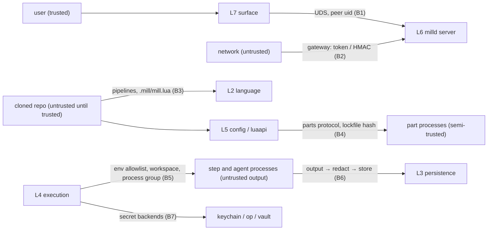

# Security

Secrets broker and redaction, sandboxing of CEL and Lua, plugin trust, the socket and gateway, and a threat model mapped to the layers of [layers.md](layers.md) (§8). Refines spec §21, §22. Citations use the keys in [references.md](references.md).

Layers: the redactor is `redact` (L0); the broker and backends are `secrets` (L4); CEL's secret handle is in `expr` (L2); trust, plugins and Lua sandboxes are L5 (`parthost`, `plugins`, `luaapi`); the socket and gateway are L6.

## 1. Secrets broker

### 1.1 Flow

Least privilege per node-run [BSRS ch. 5]: a part receives only the secrets its node references, only for that node-run.

1. **Declare.** A pipeline lists the names it may use in `secrets:`. Lint fails M9201 for any `secrets.X` reference not declared.
2. **Resolve at run start.** Before any node-run is created, the broker resolves every declared name that some node actually references (a name declared but unused is not fetched). Missing → the run fails immediately with M9202 and `help: mill secrets set NAME` (spec §29.9). Backends are tried in configured order (`mill.secrets { backends = {...} }`, default `env, keychain`); the first hit wins. Resolution happens in a helper goroutine with a timeout (10 s per backend; `op` can prompt for biometrics, which counts as a failure in a non-interactive daemon).
3. **Hold.** Values live in the run actor's memory as `secrets.Value` (a byte slice wrapper whose `String`, `GoString`, `MarshalJSON`, `Format` all print `•••`). They are zeroed best-effort when the run ends. They're never written to disk by mill.
4. **Grant.** Per node-run, the grant is the set of `secrets.X` handles appearing in that node's `with`, `env`, or `secrets:` list. A part receives only its grant.
5. **Deliver.**
   - Exec processes: only through environment variables (`env: { GH_TOKEN: ${{ secrets.GITHUB_TOKEN }} }`). Never argv (lint M9207 + runtime argv scan).
   - In-process built-ins: `OpenRequest.Secrets.Reveal(name)`.
   - Executable parts: `Open.secrets` over the pipe (not visible in `ps`).
   - Lua parts: `ctx.secret(name)` returns the value only inside the part's state; `tostring` of a handle elsewhere gives `•••`.
6. **Redact.** Every value (and its encodings, §2) is registered with the run's redactor at resolution time, before anything that could echo it runs.

### 1.2 CEL handle type

A hardened type makes the unsafe use a compile error instead of a review comment [BSRS ch. 12].

`secrets` in CEL is a map of opaque values of type `mill.Secret`. The only operations are: pass it as a whole field value (`token: ${{ secrets.X }}`) to a field the part's schema marks `"x-mill-secret": true`, or to an `env` entry. `string(secret)`, concatenation and interpolation inside a larger string are type errors at compile time (M9204), so `"Bearer ${{ secrets.X }}"` fails lint with a hint to use the part's `auth` field or an env var.

### 1.3 Backends

| Backend | How | Notes |
|---|---|---|
| `env` | `os.Getenv` of the daemon (and, for `--local`, the CLI process) | CI path (spec §17.12) |
| `keychain` | `zalando/go-keyring`, service `mill`, account = secret name | `mill secrets set` writes here by default. Verify macOS `Set` doesn't pass the value on argv; if it does, write via `security -i` over stdin. |
| `1password` | `op read op://vault/item/field` with `--no-newline`, value on stdout | needs `op` signed in; service account token via env for headless |
| `vault` | HTTP API (`GET /v1/<mount>/data/<path>`), token from env `VAULT_TOKEN` or a file | no SDK |
| `agefile` | `~/.config/mill/secrets.age` decrypted with an identity from `MILL_AGE_IDENTITY` (path) | headless servers |

`mill secrets test NAME` resolves through the same chain and prints only `ok · from keychain` or the error.

## 2. Redaction

`redact.Redactor` (L0, was `secrets/redact`, D33), one per run (plus a daemon-wide one for config-level secrets such as MCP server env).

- **Patterns per secret:** the raw value, standard and URL-safe base64 (with and without padding), URL query-escaping, JSON string escaping, and hex for values ≤ 64 bytes. Values shorter than 6 bytes are not registered (they'd redact ordinary text) and produce warning M9206 at resolution.
- **Matcher:** Aho–Corasick over all patterns (own implementation, ~200 lines, fuzzed), replacing each match with `•••`.
- **Streams:** log writers wrap the redactor in a streaming mode that holds back `maxPatternLen − 1` bytes between writes, so a secret split across two `read()` chunks is still caught. Flushed on close.
- **Where it runs:** process stdout/stderr before logs are written; every item before it's appended; every event before append; every client event (the bus encodes from already-redacted events); error messages and `stderr_tail`; argv in `NodeRunStarting`; text artifacts produced by mill (transcripts, diffs).
- **Step-produced artifacts:** text files (≤ 50 MiB, valid UTF-8) collected from `MILL_ARTIFACTS` are redacted on the way into the CAS and get `redacted: true` in their `FileRef` if anything changed. Binary files are scanned; if a pattern is found the node fails M9205 rather than storing a secret (decision D13, default accepted; spec §21).

**Spec conflict resolved.** Invariant 5 says raw output is stored as-is; invariant 9 says secret values never appear in logs or artifacts. They can't both hold literally. The rule we implement: **redaction is the only transformation applied before persistence**. "Raw" means "byte-faithful except that registered secret values are replaced". Faithful replay therefore never reproduces a secret, which is the safer reading.

**Limits** (documented, not hidden): a secret the agent transforms (reverses, splits with spaces, hashes) won't be caught; secrets that never passed through the broker (a token in the user's own shell config that a step prints) aren't known to the redactor. `mill export` adds a pattern-based scanner (entropy + known token formats like `ghp_`, `sk-`, `xoxb-`) on top.

## 3. Sandboxes

### 3.1 CEL

- Environment built once per pipeline hash with only mill's declared variables and pure helpers (`json`, `yaml`, `text`, `lines`, `trim`, `slug`, `hash`, `glob` over **item data**, not the filesystem, `duration`, `template`, `default`). No helper performs I/O.
- `cel.CostLimit(1_000_000)` per evaluation and `cel.InterruptCheckFrequency(100)` with a 100 ms context deadline. Exceeding either → M3110 with the expression's position.
- Results larger than 16 MiB → M3111.
- `now` is fixed per node-run (recorded), so evaluation is deterministic and replayable.

### 3.2 Lua

Four profiles, all on gopher-lua with `SkipOpenLibs: true` and explicit library loading:

| Profile | Used for | Libraries | Limits |
|---|---|---|---|
| `trusted` | `init.lua`, `~/.config/mill/lua/` | base, table, string, math, os, io, package (user's own config is trusted like an editor config, spec §19.5) | config phase 2 s; hooks 1 s per call (rex Dispatcher pattern: bounded coalescing queue, never called on the store's broadcast path) |
| `data` | `plugin.lua`, untrusted `.mill/mill.lua`, `settings.lua` | base without `dofile`, `loadfile`, `load`, `require`, `collectgarbage`, `print`; table, string, math. `mill.*` declaration functions record data; hooks/commands/parts recorded as "needs trust" | 2 s, `CallStackSize` 128, `RegistryMaxSize` 1 M slots |
| `transform` | `lua` node part (spec §8) | base (no file/load functions), table, string, math, `mill.json`, `mill.slug` | per-call 1 s default (`timeout` on the node), registry cap; `unsafe: true` in a trusted pipeline switches to `trusted` |
| `part` | Lua parts from plugins | `transform` + `ctx.http` (only to manifest `permissions.network` hosts), `ctx.secret` (granted only), `ctx.fs` (only declared paths via `os.Root`), `ctx.log/progress/artifact` | per-call deadline from the node timeout; one `LState` per plugin, serialized |

All profiles run with `L.SetContext(ctx)` so deadlines interrupt loops. gopher-lua has no hard memory cap; `RegistryMaxSize` bounds the value stack/registry, and untrusted Lua parts are additionally limited to one state per plugin. This is a robustness boundary, not a strong isolation boundary; WASM parts (wazero, later) are the answer for untrusted heavy code.

`ctx.http` network rules: host must match the manifest allowlist exactly (or `*.domain` wildcard); redirects to other hosts are refused; resolved addresses in loopback, link-local and private ranges are refused unless the allowlist names them explicitly (SSRF guard). TLS verification can't be disabled from Lua.

## 4. Pipeline and project trust

A fresh clone is attacker-controlled input until the user says otherwise [BSRS ch. 2]; config from it can't widen trust ([configuration.md](configuration.md) §2).

| Source | Default | To run |
|---|---|---|
| `~/.config/mill/pipelines/` | trusted | |
| `.mill/pipelines/` in a project dir the user has trusted (`mill trust .`, or `mill setup` adding the dir to `trusted_projects`) | trusted | |
| `.mill/pipelines/` in a project not yet trusted (e.g. freshly cloned) | **untrusted**: listed with a `needs trust` badge, triggers never armed, manual `mill run` refused M9101 with `help: mill trust .` | `mill trust .` reviews and records `{path, sha256}` for config and every pipeline |
| imported/downloaded pipelines | untrusted until `mill trust <file>` | trust recorded by bundle hash; any change requires trust again |

This tightens spec §22 ("pipelines in your own repo are trusted"): mill can't tell "your" repo from a cloned one, and a cloned repo with an `fswatch` or `cron` trigger would otherwise start running code as soon as milld sees it. Decision D18 (user, 2026-11-11), applied in spec §22.

Trust records: `~/.local/share/mill/trust.json` (`[{kind, path, sha256, at}]`), written atomically.

## 5. Plugins

- **Resolution never shadows silently.** Built-ins, user plugins, project plugins and inline parts resolve per spec §9.4, but `mill-part-<name>` executables on `PATH` and MCP tools **only fill ids that aren't already taken**; overriding a built-in requires an explicit alias or `override = true` in config. Spec §9.4 says later sources override earlier ones, which lets any binary on `PATH` named `mill-part-sh` replace `sh`. Decision D19 (user, 2026-11-11), applied in spec §9.4.
- **Lockfile** (`mill.lock`; the spec doesn't fix a format, JSON keeps it boring and diffable with sorted keys):

```json
{"lock_v":1,"plugins":{"acme/linear":{"source":"registry:acme/linear","version":"1.2.0","archive_sha256":"…","files":{"parts/bin/linear-hook-darwin-arm64":"…"},"requires":{"mill/http":"1.0.3"},"permissions":{"network":["api.linear.app"],"destructive":["linear.issue.update"]}}}}
```

- **Start check:** before starting an executable part, hash the binary and compare with the lock; mismatch → refuse M5301 with both hashes.
- **Permissions:** shown at install; any update that adds permissions needs explicit approval (spec §18.9). Enforced for Lua parts (§3.2), declared-only for native executables unless `plugins.sandbox = "container"`.
- **Signatures:** deferred to the registry milestone. Lockfile hashes give integrity for anything already installed.
- **Build from source** (`build = { from = "go", … }`): runs `go build` in a temp dir with `GOFLAGS=-mod=readonly`, `GOTOOLCHAIN=local`, network allowed only for module download, and never with the user's secrets in env.

## 6. Local socket and gateway

**Socket.** `0600` file in a `0700` dir, peer uid check (rex `verifyPeer`), max line 16 MiB, per-connection queue caps. Anyone who can talk to the socket can run arbitrary pipelines as the user, so the uid check is the real boundary, not the mode bits.

**Gateway** (M7, off by default):

| Control | Rule |
|---|---|
| Bind | `gateway.listen` default unset; when set, refuse non-loopback addresses unless `gateway.allow_public = true` (then a startup warning) |
| Webhooks | per-trigger secret required (lint M9310 if missing); verification: `token` (constant-time compare of header/query token), `hmac` (`X-Mill-Signature: sha256=…`), `github-hmac` (`X-Hub-Signature-256`), `stripe` (`Stripe-Signature` with timestamp tolerance 5 min) |
| Replay | dedupe on delivery ids (`X-GitHub-Delivery`, Stripe event id) within `dedupe_window` (default 24 h) |
| Limits | body ≤ 1 MiB (`webhook.max_body`), 10 req/s per path token bucket, 30 s read timeout, `http.Server` timeouts set (header 5 s, idle 60 s) |
| Remote API / WebSocket | bearer tokens created with `mill gateway token create --scope read|run|admin`, stored hashed (sha256) in `gateway/tokens.json`; same envelopes as the socket |
| Responses | errors use the §29.3 object; never echo request bodies |
| Public exposure | only via a tunnel or the hosted relay (spec §22) |

## 7. Threat model

| # | Asset / boundary | Threat | Mitigation | Residual |
|---|---|---|---|---|
| T1 | User's machine via a cloned repo | Malicious `.mill/` pipelines or `mill.lua` auto-run (triggers, hooks) | Untrusted projects: data-only Lua, no armed triggers, manual runs refused until `mill trust .` (§4) | User trusts without reading |
| T2 | Secrets in transit to steps | Leak via `ps`/argv | Env/protocol only; lint + runtime argv scan (M9207) | Child process may itself put it on argv |
| T3 | Secrets at rest | Secrets in logs/items/events/artifacts | Broker-registered redaction before every persist; binary artifacts with secrets refused | Transformed secrets; unregistered secrets |
| T4 | Local socket | Another local user drives milld | `0600` + `0700` dir + peer uid check | Same-uid malware (out of scope) |
| T5 | Gateway | Forged webhooks, replay, DoS | Per-trigger HMAC/token, delivery dedupe, body/rate limits, localhost default | Misconfigured public bind |
| T6 | Agent with write access | Agent edits main checkout, pushes, deletes | Workspaces by default; `workspace: none` needs confirmation; destructive parts need `policy.allow_destructive`; `--dry-run` | Agent running arbitrary shell inside its workspace can still reach the network and `$HOME` unless the container runner is used |
| T7 | Agent prompt injection (issue body says "push to main") | Pipeline does something destructive the author didn't intend | Destructive capabilities are allowlisted per pipeline, not per prompt; PRs as drafts; `assert` gates; independent review | Allowed destructive actions with attacker-controlled content |
| T8 | Path traversal | `file.write path=../../.ssh/authorized_keys` | `os.Root` for all file parts; path rules (M9301) | none known |
| T9 | Plugin supply chain | Swapped binary, malicious update | Lockfile hashes, refuse on mismatch, permission diff on update, signatures (later) | First install of a malicious plugin |
| T10 | Lua/CEL from untrusted sources | Infinite loop / memory blowup in daemon | CEL cost limits; Lua deadlines, registry caps, data-only profile | gopher-lua memory not hard-capped |
| T11 | Daemon crash during destructive step | Silent double execution after restart | Write-ahead `NodeRunStarting`; non-idempotent → `crashed`, never auto re-run; orphan groups killed by identity | Part mis-declares `idempotent` |
| T12 | Exports | Secrets or personal paths shared | Export scanner blocks secret-looking strings, flags absolute paths; history excluded by default | |
| T13 | Logs / bug bundles | PII in `doctor --bundle` | Redactor + explicit listing before writing | Non-secret PII in step output |
| T14 | Env inheritance | Unrelated tokens in milld's env reach every step | `env.passthrough` allowlist (execution.md §3) | Allowlist misconfigured |

The threat ids T1–T14 above are kept stable; §8 maps them to layers.

## 8. Threat model by layer

Trust boundaries cross layers at known points [BSRS ch. 2] [BSRS ch. 6]. Each layer owns the controls for the boundaries it touches, so a review of one layer can check its threats without reading the rest.



| Layer | Boundary | Assets | Threats (ids from §7) | Controls | Tests |
|---|---|---|---|---|---|
| L0 | B6 (bytes in) | secrets in transit to disk; paths | T3 secrets at rest, T8 traversal | `redact` streaming matcher with held-back tail; `paths.CheckRoot`, `os.Root` | `FuzzRedactorChunks`, `FuzzPathSafety` |
| L1 | all (shapes) | protocol and event integrity | malformed part messages (T9 adjacent), log tampering by bugs | strict decoders, one `Done`/`Fail` per context, reducer rejects illegal transitions | `FuzzPartMessages`, `FuzzEventLogReplay` |
| L2 | B3 | the user's machine via a pipeline file | T10 CEL abuse, T2 secrets in argv, T7 prompt injection reaching destructive parts | CEL cost and time limits, opaque secret type (M9204), argv lint (M9207), `policy.allow_destructive` lint (M3204), no I/O in helpers | `FuzzCELHelpers`, lint goldens |
| L3 | B6 | run history, artifacts | T3, T12 exports, T13 bundles | redaction before every append; 0600/0700 modes; CAS blobs 0400; export and bundle scanners | `TestSecrets_NotOnDisk`, file-mode tests |
| L4 | B5, B7 | secrets, the main checkout, the host | T2, T6 agent writes, T11 double execution, T14 env leaks | grants per node-run, env allowlist (ADR-031), workspaces by default, write-ahead + crash-don't-guess, process groups/Job Objects, container runner `network: none` | `TestCancel_NeverFailed`, crash-point exploration, `TestShEnvAllowlist` |
| L5 | B3, B4 | the user's machine via config, plugins and parts | T1 auto-run from clones, T9 supply chain, T10 Lua, T7 | data-only Lua for untrusted config, no armed triggers until `mill trust .`, built-in ids win (ADR-041), lockfile hashes (M5301), Lua deadlines and network allowlists with SSRF guard | sandbox escape tests, `TestConfig_ProjectCannotWidenTrust`, lockfile tests |
| L6 | B1, B2 | control of `milld` (= run anything as the user) | T4 local socket, T5 gateway | peer uid check, 0600 socket in 0700 dir, line caps; gateway off by default, loopback bind, per-trigger HMAC/token, replay dedupe, body and rate limits, hashed API tokens | peer-cred tests, forged-webhook tests |
| L7 | user | the user's terminal and scripts | terminal escape injection from step output; secrets on screen | the TUI renders sanitized copies (raw bytes only in attach view, through the vt10x emulator); redacted errors; `--json` never includes secrets | golden output with ANSI-laden fixtures |

### 8.1 Security fitness functions

| Check | Tool | Guards |
|---|---|---|
| `gosec` (in rex's linter set) with no blanket excludes | golangci-lint | common Go footguns |
| forbidigo: `exec.Command` only in `proc`, runners, `workspace`, `daemonctl`; `os.Getenv` only in `paths`, `config`, `secrets` ([layers.md](layers.md) §8.3) | golangci-lint | T2, T14 |
| A6 built-ins can't import `secrets`, `store`, `engine` ([layers.md](layers.md) §8.1) | archtest | principle 7; secrets reach parts only through grants |
| `secrets.Value` has no exported field and its `String`, `GoString`, `Format`, `MarshalJSON`, `MarshalText` return `•••` (reflection test) | unit | T3 |
| `TestSecrets_NotOnDisk`, `TestErrors_Redacted` | integration | invariant 9 |
| `govulncheck` | `make vuln` | dependencies |
| Fixture scanner (token-shaped strings, personal paths) | `fixtures_lint_test.go` | synthetic data rule |

## 9. Sources

| Decision | Follows |
|---|---|
| Threat model by adversary and boundary | [BSRS ch. 2] |
| Least privilege: per-node grants, env allowlist, trust gate | [BSRS ch. 5] |
| Small understandable boundaries per layer | [BSRS ch. 6] |
| Hardened secret type; misuse is a compile error | [BSRS ch. 12] |
| Fuzzing the parsers and the redactor | [BSRS ch. 13] |
| Crash, don't guess for destructive steps | [BSRS ch. 9] [RI ch. 5, Let It Crash] |
| Gateway limits and replay protection | [RI ch. 5, Shed Load] [EIP, Idempotent Receiver] |
