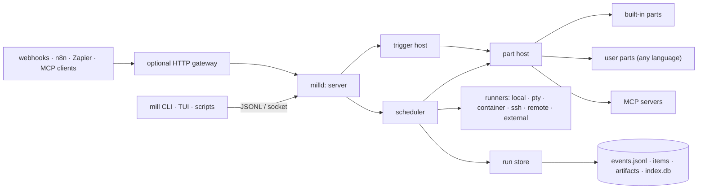

## 5. Architecture

### 5.1 Processes

| Process | Role |
|---|---|
| `mill` | Client. CLI subcommands, the TUI, pipe expressions. Dials the daemon over a local socket and auto-starts it if it isn't running. |
| `milld` | Daemon. Loads pipelines, hosts parts, runs triggers, schedules node-runs, supervises child processes, writes the run store. |
| Part processes | Long-lived or per-call child processes of `milld` that speak the parts protocol (§9). |
| Step processes | Programs launched by runners for `exec`-style nodes and agents. |

### 5.2 Components

| Component | Responsibility |
|---|---|
| **Server** | Socket listener, handshake, intent handlers, per-connection ordered event queues. |
| **Pipeline loader** | Parse, validate (lint) and compile `*.mill.yaml` and pipe expressions into an execution graph. Watches pipeline directories and reloads on change. |
| **Scheduler** | Ready-queue over the execution graph. Enforces concurrency caps and budgets. Decides when each node-run starts. |
| **Part host** | Starts, pools, health-checks and stops part processes. Routes messages between the scheduler and parts. |
| **Runner layer** | Executes node-runs in the right place. Owns process groups, PTYs, containers and SSH sessions. |
| **Trigger host** | Runs trigger parts. Turns their events into new runs, with dedupe, debounce and concurrency policy. |
| **Run store** | Appends events to each run's log. Writes items and artifacts. Maintains the rebuildable SQLite index. |
| **Workspace manager** | Creates and cleans up worktrees, temp dirs and volumes. Enforces path safety rules. |
| **Secrets broker** | Resolves secret references through secret-backend parts, injects them only where they're declared, and registers values for redaction. |
| **Expression engine** | Evaluates `${{ }}` expressions (CEL) and Lua transform scripts in a sandbox. |
| **Gateway** (optional) | HTTP and WebSocket front door: webhook triggers, the remote API and gate links. Off by default; binds to localhost when on. |

### 5.3 Design decisions

| Decision | Rationale |
|---|---|
| Hands-off runs | Pipelines are only useful as automation if they finish on their own. Anything that needs a person is a handoff, so runs stay predictable, scriptable and safe to schedule. |
| Two binaries over a local socket | The TUI can exit without stopping runs. Multiple clients. Scriptable. A crash in a client never takes down a run. |
| JSONL wire format | Debuggable with `socat` and `jq`. Language-agnostic. The same envelope is used for the daemon protocol and the parts protocol. |
| Parts are processes, not in-process plugins | Any language, crash isolation, independent upgrades, easy sandboxing. In-process speed only matters for the few hot built-ins. |
| Built-ins use the public parts protocol | Keeps the protocol honest and complete. Built-ins run in-process behind the same interface, and a loopback conformance suite proves they behave the same over the wire (`milld part serve <id>` runs one over stdio). Replacing a built-in takes an explicit override (§9.4). |
| Event-sourced run log | Faithful replay, crash recovery, audit trail. The index can always be rebuilt. |
| YAML pipelines + layout sidecar | Logic diffs stay clean. Moving a box on the canvas doesn't touch the pipeline file. |
| CEL for expressions | Safe (no side effects, always terminates), typed, fast, widely known. |
| Lua for config, YAML for pipelines | Config benefits from logic and comments. Pipelines must round-trip losslessly through the canvas editor, which needs plain data. |
| Lua for inline scripts and small parts | Tiny, embeddable, easy to sandbox. One extension language everywhere. |
| Agent registry as Lua tables | New agent CLIs need no code. Works for tools that haven't been released yet. |
| One package format for plugins and pipeline bundles | One install, trust and lock flow to learn. Sharing a pipeline brings its dependencies with it. |
| Go | One static binary per platform, goroutines for the daemon, reference CEL, a mature TUI ecosystem (§27). |
| Crash, don't guess | After a daemon restart, a live non-idempotent step is marked `crashed` and the run fails with a clear error. mill never silently re-runs something that might have had side effects; you re-run it explicitly with `mill rerun --from`. |

### 5.4 Invariants

1. One JSON object per line on every mill socket and every part's stdio. The envelope field `v` must match the protocol version.
2. A connection receives no broadcast events until its `Hello` completes.
3. Binary data on the wire is base64-encoded.
4. Run logs are append-only. Nothing rewrites history; corrections are new events.
5. Raw step output is stored byte for byte, except that registered secret values are replaced with `•••` (§21). Redaction is the only transformation before anything is persisted. Classification and display use sanitized copies.
6. A node-run in a terminal state never changes state again.
7. Concurrency slots are acquired before a node-run starts and released when it reaches a terminal state, whatever the path.
8. Cancel and delete share one teardown path: kill the process group, drain output for a bounded time, release resources. No transient `failed` state appears during teardown.
9. Resolved secret values never appear in run logs, items, artifacts or client events.
10. Reloading pipelines never changes a run already in progress. A run executes the pipeline version (content hash) it started with.

---

[← spec index](index.md)
